<div align="center">

**English** · [简体中文](README.zh-CN.md)

# ◉ DOT · AI Cross-Border Remittance Agent

**A finance agent that understands, plans and executes safely — with its own on-chain wallet, spending only inside the limits you grant.**

     

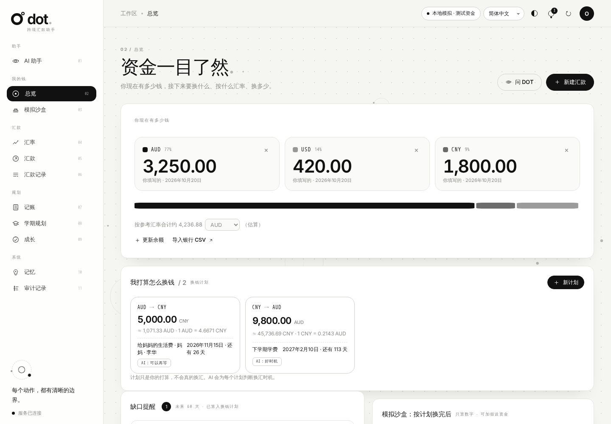

</div>

---

## What it is

Sending money across borders means weighing exchange rates, fees, available funds, recipient details and delivery time at once. **The amount implied by a reference rate is not what arrives after charges**, and the lowest advertised fee does not always deliver the most.

DOT is a natural-language AI agent that helps you:

- 🔍 **Read rates honestly** — real ECB daily reference rates with source and timestamp, and historical position interpreted for *your* transfer direction
- ⚖️ **Compare options** — reference calculations, simulated options and the sandbox quote are kept strictly apart, ranked by amount received or speed
- 📝 **Prepare payments** — fix the amount you send, or the amount the recipient must receive (reverse-quoted)
- 🛡️ **Execute safely** — 13 guardrail checks plus your explicit authorization; the agent can never approve its own payment
- ⛓️ **Spend on-chain autonomously** — the agent owns an encrypted wallet and signs transfers by itself, but only inside a mandate you grant (fixed recipient, per-payment cap, total budget, expiry)
- 🧾 **Trace everything** — one audit trail answers who authorized what, which checks ran, and what happened next

> Implements every functional module (4.1–4.15) of the product specification *AI Cross-Border Remittance Assistant* v4.0 — see the [requirements mapping](#-requirements-mapping).

---

## ✨ Highlights

### 1. Understand → plan → act, every stage visible

On each turn the agent first calls `record_plan` to record its **intent, extracted amounts/currencies/recipient, missing details and planned steps**, then calls tools within its permission tier. The three stages stream live over SSE, and tool results render as cards (rates, comparisons, drafts, on-chain status), each labeled by data kind — reference data, simulation, ledger record or on-chain state.

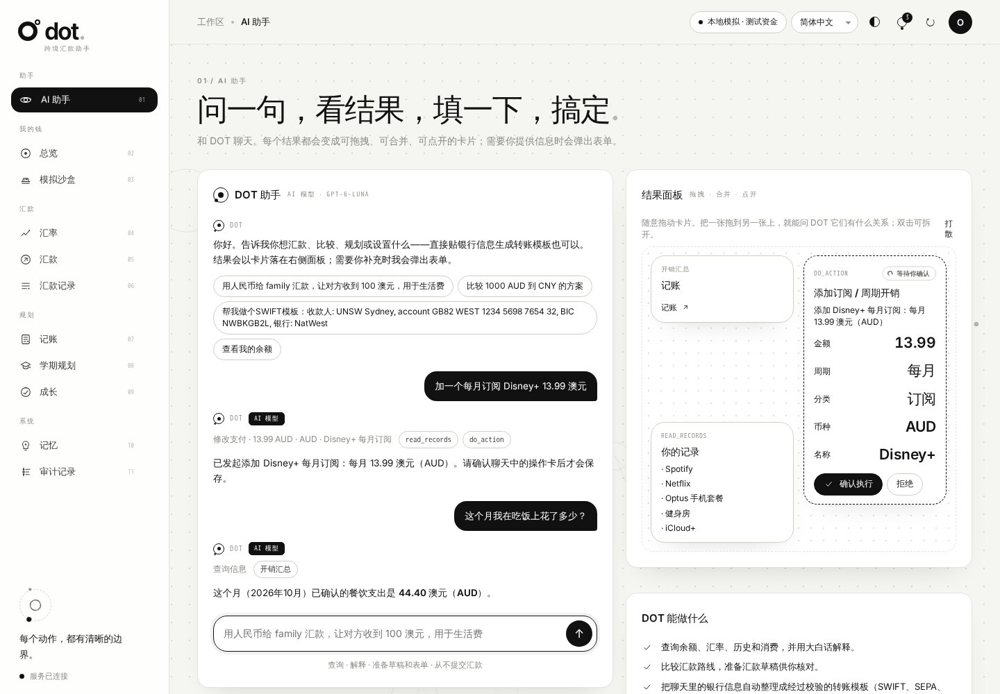

- Without a model key, an **offline rule planner** drives the same pipeline (clearly labeled “not an AI model”). It understands common intents in 6 languages, asks for missing details and fills them from your next message.
- Configure any **OpenAI-compatible** model with function calling and it becomes a real AI agent.
- The model has **no** tool to approve payments, grant mandates or raise limits — saying “OK” never authorizes anything.

### 2. Compare before you send

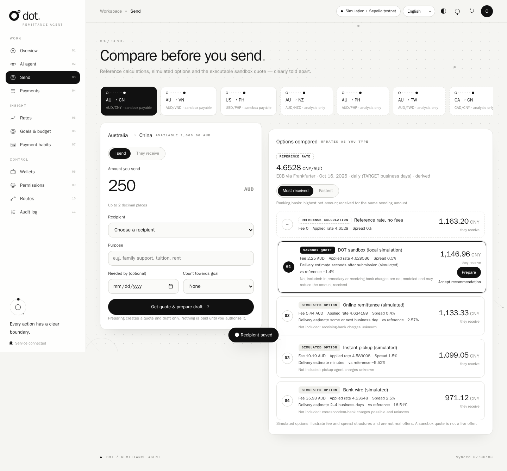

Live comparison as you type: a reference-rate benchmark, three simulated options (bank wire / online remittance / instant pickup) and the executable sandbox quote — with fixed and percentage fees, applied rate, spread, delivery estimate, loss versus reference, and **charges not included**.

### 3. Authorization is a deliberate act

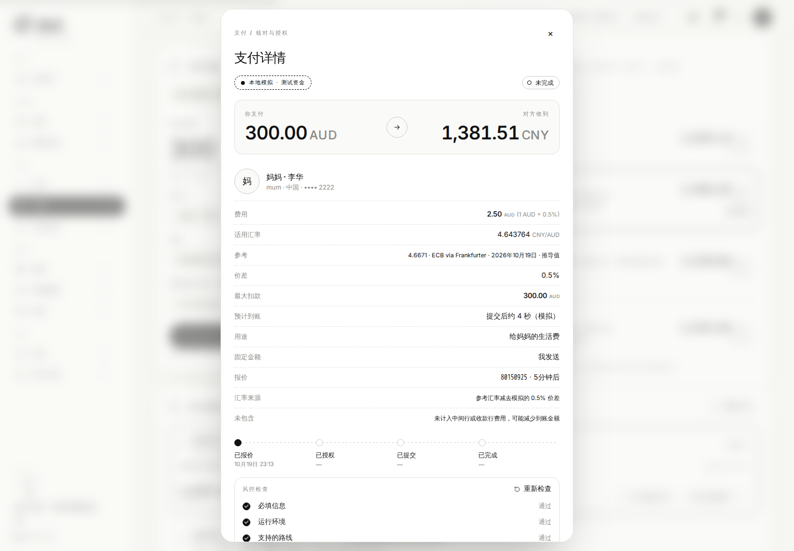

The authorization screen shows the environment label, exact amounts, rate source, a live quote countdown, the status timeline and every guardrail check. After ticking the confirmation you must **press and hold** the ring. The approval is bound to a SHA-256 digest of the exact details — any change voids it.

### 4. The AI owns its own wallet

On first start the backend creates an **encrypted keystore** for the agent. The private key lives only in the signer process — never in the model, the browser or the logs. Once you grant a mandate on the Permissions page, the agent can send Sepolia ETH on its own within that scope and tracks each transaction to the required confirmations.

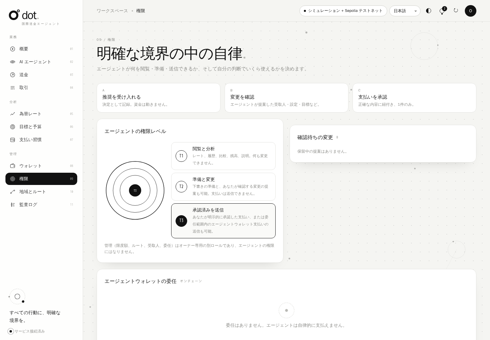

### 5. Tools and memory

**Tools** live in [`finance/tools.py`](finance/tools.py). Each tool is declared once with `@tool(name, description, params, tier)` next to its implementation; the agent validates arguments, checks the tier (T1 view / T2 prepare / T3 submit) and audits every call. There are 26 tools, including `remember_note`, `recall_memory` and `forget_note` — and deliberately none that approve payments, grant mandates, raise limits or change recipients. Adding a tool is one decorated function.

**Memory** lives in [`finance/memory.py`](finance/memory.py), in three layers:

| Layer | What it holds | How it is used |
| --- | --- | --- |
| Conversation | The last 12 turns of each session | Sent with every request so follow-ups make sense |
| Notes | Durable facts you ask it to keep — people, routines, preferences | The most relevant notes are injected each turn as *data*; the agent saves them with `remember_note`, you review and delete them on the **Memory** page |
| Episodes | One record per turn: request, intent, tools run (and blocked), payments touched, outcome | Searchable with `recall_memory`; recent episodes give the agent continuity |

Recall works across languages (word matching for Latin scripts, character bigrams for CJK). Memory refuses passwords, keys and full account or card numbers, never grants permissions, and is never treated as proof of a balance or payment.

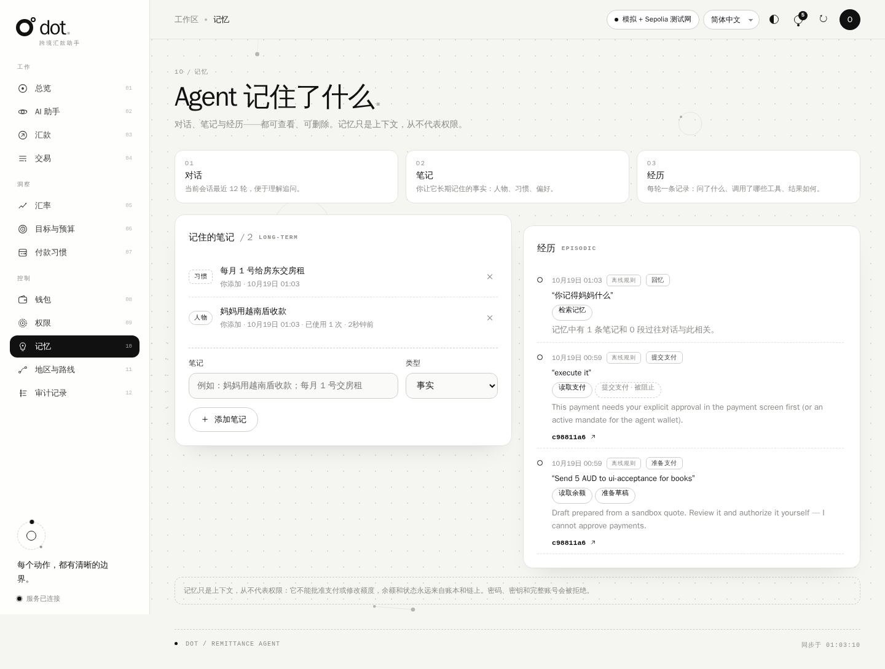

### 6. Black & white · dots, lines, circles · in motion

| Pull close · depth-of-field blur | Dark mode |
| --- | --- |
| 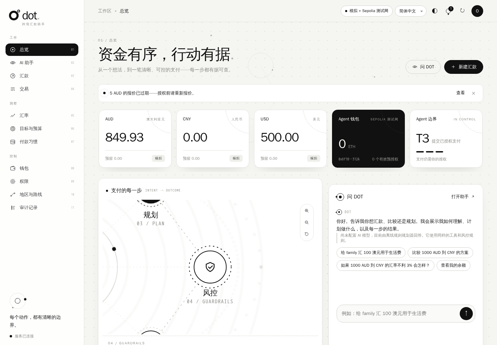 | 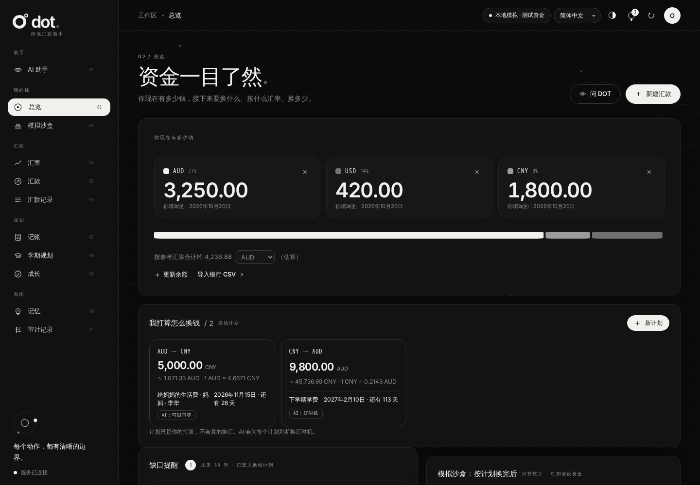 |

- The dot-grid background becomes a **magnifying lens** around the cursor; a constellation of dots, lines and circles drifts with scroll parallax
- **Depth transitions** between pages: going forward pushes the old page away and blurs it while the new one pulls close; **swipe** between pages on mobile
- The journey orbit and the rate chart support **wheel / pinch zoom and drag to pan**; clicking a node pulls the camera close and blurs the background layers
- Modals zoom out of the click point over a blurred backdrop; scroll reveal, 3D card tilt, magnetic buttons, count-up numbers, line-drawing animations
- Respects `prefers-reduced-motion`; zero external dependencies under a strict `'self'` CSP

### 7. Six languages

English · 简体中文 · 繁體中文 · Tiếng Việt · 日本語 · 한국어 — numbers, dates and region names localized with `Intl`; backend errors arrive as stable codes and are translated in the UI.

| 한국어 | Tiếng Việt |
| --- | --- |
| 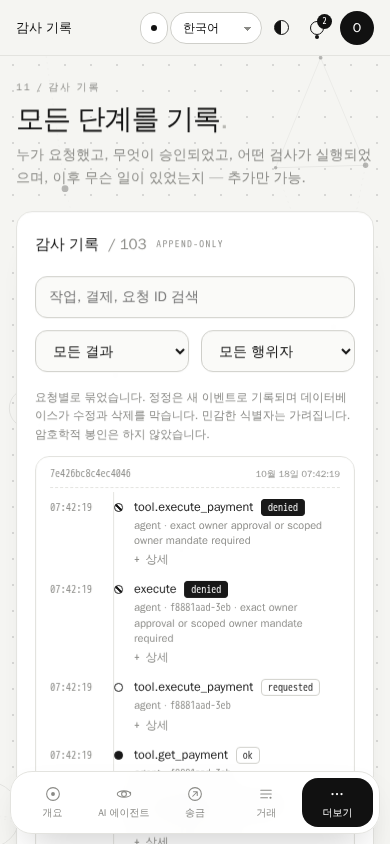 | 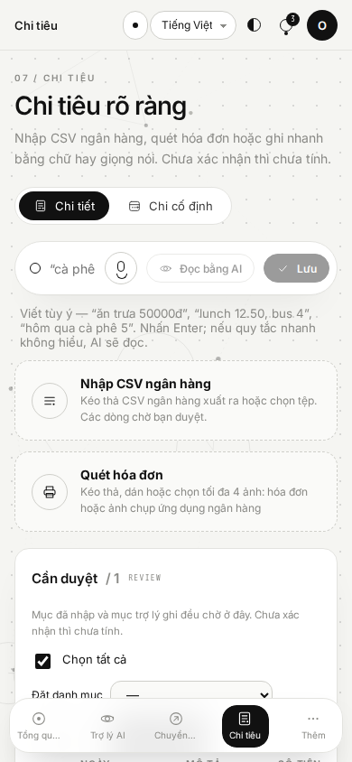 |

---

## 🏗 Architecture

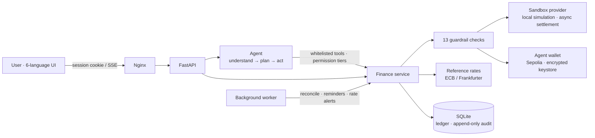

| Module | Files |
| --- | --- |
| Agent orchestration (model loop, streaming, episodes) | `finance/agent.py` |
| **Tool registry** — every tool's schema, tier and implementation | `finance/tools.py` |
| **Memory** — conversation, notes, episodes, recall | `finance/memory.py` |
| Offline rule planner | `finance/agent_rules.py` |
| Payments core, guardrails, approvals, mandates, routes | `finance/service.py` |
| Comparison, scenarios, goals & budget, decisions & proposals | `finance/planning.py` |
| Payment habits, deduplicated reminders, rate alerts | `finance/habits.py` |
| Reference rates, historical analysis, backtested forecast | `finance/rates.py` |
| Sandbox provider / EVM wallet | `finance/providers.py`, `finance/wallet.py` |
| API, SSE, standalone server | `finance/api.py`, `finance/web.py`, `finance/worker.py` |
| Frontend (native ES modules) | `frontend/dist/js/**` |

---

## 👥 For teammates: run it after cloning

**You need:** access to this private repository (ask the owner to add you as a collaborator), [Git](https://git-scm.com/), [Python 3.10+](https://www.python.org/downloads/) and [Docker Desktop](https://www.docker.com/products/docker-desktop/) (running).

```bash
git clone https://github.com/ytan0008/dot-remittance-agent.git
cd dot-remittance-agent
python scripts/configure.py          # creates your own .env (tokens, wallet password); prints no secrets
docker compose up --build -d --wait  # first build takes a few minutes
```

Open **http://localhost:8787** — you are signed in automatically as the local owner.

- **AI model (optional):** put *your own* key in `.env` → `OPENAI_API_KEY=sk-...` (model `gpt-6-luna` is preset), save, then `docker compose up -d --force-recreate backend`. Without a key the agent runs in the labeled offline rule mode. Never commit `.env` or share keys in chat.
- **Your data is yours:** each clone gets its own database, test funds and its own agent wallet address; nothing is shared with other teammates.
- **Port busy?** add `FRONTEND_PORT=8799` to `.env` and open that port instead.
- **Update to the latest code:** `git pull` then `docker compose up --build -d --wait`.
- **Stop / start:** `docker compose stop` / `docker compose up -d`. Reset all local data: `docker compose down -v` (also deletes the agent wallet).
- **Run tests without Docker:** `python -m venv .venv`, then `.venv\Scripts\pip install -r requirements.lock.txt` (macOS/Linux: `.venv/bin/pip`), then `python -m pytest -q`.

## 🚀 Getting started

### Docker (recommended)

```powershell
python -m venv .venv
.\.venv\Scripts\python -m pip install -r requirements.lock.txt
.\.venv\Scripts\python scripts/configure.py      # writes .env: tokens, Sepolia RPC, wallet password (never printed)
docker compose up --build -d --wait
```

Open **http://localhost:8787**. Local demo mode signs you in as the owner automatically (demo login is always refused when a live chain is configured).

### Without Docker

```powershell
$env:EVM_RPC_URL = 'https://ethereum-sepolia-rpc.publicnode.com'   # leave empty to run the sandbox only
$env:AGENT_WALLET_PASSWORD = '<at least 12 characters>'
$env:ENABLE_DEMO_LOGIN = 'true'
.\.venv\Scripts\python -m finance.cli serve       # UI: http://127.0.0.1:8000 · API docs: /api/docs
```

### Connect a language model (optional)

Set `OPENAI_API_KEY`, `OPENAI_MODEL` and optionally `OPENAI_BASE_URL` (any OpenAI-compatible service) in `.env`, then run `docker compose up -d --force-recreate backend`.

### Let the agent spend on-chain by itself

1. On **Wallets**, copy the agent's address and fund it with test ETH from a Sepolia faucet
2. **Wallets → Add recipient → Agent wallet**: enter the receiving address
3. On **Permissions**, grant a mandate: recipient, per-payment cap, total budget, validity (≤ 7 days; gas counts toward the budget)
4. Tell the agent `Send 0.001 ETH to <recipient-id> for test`, then `execute it` — it signs and broadcasts inside the mandate, and the receipt links to Etherscan

### Sandbox test amounts

| Amount ending in | Result |
| --- | --- |
| anything else | submitted → processing → completed after ~8 s, settled exactly once |
| `.13` | provider rejects → failed, reservation released |
| `.57` | response lost → “outcome unknown”; the original payment is found by its own ID — **never a second payment** |

---

## 📋 Requirements mapping

| Module | What is implemented |
| --- | --- |
| 4.1 Funds & transfer requirements | Fixed send amount or target receive amount (reverse quote never delivers less); purpose, arrival date, linked goal; missing details are asked for first |
| 4.2 Regional & APEC routes | 21 APEC economies (currency / languages / time zones); add, enable and disable routes; payments enabled separately and only where the provider supports the pair; capabilities verified against reference data |
| 4.3 Latest rates | ECB first, Frankfurter blended composite when ECB lacks the pair (labeled); source, direction, observation date, frequency, change, cross-rate derivation; **never invented** |
| 4.4 Historical analysis | 30/90/365-day min, max, average, percentile, low/mid/high position, new highs/lows, coverage; read in your direction |
| 4.5 Forecasts & scenarios | Experimental 7-day model with rolling backtest against an unchanged-rate baseline and held-out interval coverage; scenario calculator |
| 4.6 Transfer comparison | Reference calculation / simulated option / sandbox quote kept apart; ranking by receive or speed with its basis; undisclosed charges listed |
| 4.7 Multi-currency funds | Per-currency total / available / reserved; reference equivalents with source, labeled “not a conversion”; settle only on confirmed completion, release only on confirmed failure |
| 4.8 Goals & budget | Completed and planned kept apart; income / expense / safety buffer / user-entered holdings; one-time vs installments and funding shortfall |
| 4.9 Natural-language agent | Mandatory plan first; three stages streamed over SSE; data-kind labels; chat and UI share one state |
| 4.10 Permission tiers & guardrails | T1 view / T2 prepare / T3 submit; 13 checks run before approval and again before submission, each recorded in the audit log |
| 4.11 End-to-end sandbox transfer | Quote → guardrails → authorization screen → hold to authorize → idempotent submit → async tracking → settlement → receipt; failure and timeout recovery |
| 4.12 Approvals & history | Accepting a recommendation, confirming a change and authorizing a payment are recorded separately; any change voids the old approval |
| 4.13 Audit log | Time, actor, action, outcome, correlation ID, request ID; denials recorded too; sensitive identifiers masked; triggers block edits and deletes |
| 4.14 Credit-building support | Obligations with monthly recurrence, on-time / late history, an internal indicator clearly labeled “not a credit score”, credit education |
| 4.15 Reminders & receipts | Deadlines, quote expiry, unresolved payments, insufficient funds, target rates; fingerprint deduplication; printable receipts |

---

## 🔐 Security model

- **Separate roles**: owner / agent / viewer tokens are distinguished server-side; browser sessions use HttpOnly + SameSite=Strict cookies and writes require a same-origin header
- **Bound authorization**: every sandbox payment needs the owner's approval of its quote digest; any field change, recipient change or quote expiry voids it
- **On-chain**: the signed transaction is persisted before broadcast; no new nonce while unresolved; chain ID and block hash checked; gas ceiling; plain native ETH to normal accounts only; non-Sepolia chains need an explicit opt-in and a separate database
- **Exact amounts**: integer minor units everywhere; values above 2^53 travel as strings and are formatted with BigInt in the browser
- **Model constraints**: tool whitelist, argument validation, bounded rounds; messages that look like private keys or API keys are rejected

---

## 🧪 Tests

```powershell
.\.venv\Scripts\python -m pytest -q        # 96 tests: service, guardrails, in-process EVM, API, rule planner, suggestions in 6 languages
.\.venv\Scripts\python -m finance.demo     # offline demo: unauthorized blocked → approve → execute → idempotent retry → timeout recovery

docker build -f tests/browser/Dockerfile -t remittance-agent-browser-test .
docker run --rm --network remittance-agent_default --mount "type=bind,source=$PWD/artifacts,target=/artifacts" remittance-agent-browser-test
```

Browser acceptance covers the full payment flow plus a sweep of 11 pages × 6 languages × desktop/mobile (no JS errors, no untranslated keys, no horizontal overflow).

---

## ⚠️ Known limits

- The spec's “provider-supported sandbox” needs real provider credentials; it is replaced by a **clearly labeled local simulation**. Connecting a provider means implementing `quote / submit / find / status`.
- The agent wallet supports plain native ETH transfers on Sepolia only. An ETH transfer is not a fiat remittance; there is no bridge or on/off-ramp.
- Forecasts are experimental; the habit indicator is not a credit score, and sandbox records do not build credit history.
- Single-user development prototype. Production would still need HSM/KMS signing, identity and MFA, multi-tenancy, rate limiting, backups and compliance review.

<div align="center"><sub>◉ DOT — every action has a clear boundary.</sub></div>
