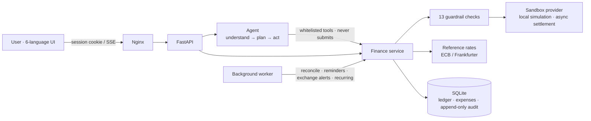

<div align="center">

**English** · [简体中文](README.zh-CN.md)

# ◉ DOT · AI Cross-Border Remittance Agent

**A finance agent that understands, plans and executes safely — it compares options, forecasts rates, reminds you when to exchange, and keeps your spending in order.**

    


</div>

---

## What it is

Sending money across borders means weighing exchange rates, fees, available funds, recipient details and delivery time at once. **The amount implied by a reference rate is not what arrives after charges**, and the lowest advertised fee does not always deliver the most.

DOT is a natural-language AI agent that helps you:

- 💬 **Do it all by chat** — anything in the app (bills, subscriptions, balances, terms, scholarships, email digest, routes, limits…) can be asked of the assistant; it prepares a confirm card and runs only when you press *Confirm*. Paying stays in your hands
- 🔍 **Read rates honestly** — real ECB daily reference rates with source and timestamp, and historical position interpreted for *your* transfer direction
- ⚖️ **Compare options** — reference calculations, simulated options and the sandbox quote are kept strictly apart, ranked by amount received or speed
- 📝 **Prepare payments** — fix the amount you send, or the amount the recipient must receive (reverse-quoted)
- 🛡️ **Execute safely** — 13 guardrail checks plus your explicit authorization; the assistant prepares and explains, but only you ever submit a payment
- 💱 **Plan your exchanges** — see how much you have in each currency, plan how much to exchange, simulate what it leaves in a sandbox, and get gap alerts per currency
- ⏰ **Exchange at a good moment** — after comparing, set reminders: a target rate, a “favorable level” (top 10–30% of the last 90 days) or an exchange-by date; optional browser notifications
- 🧾 **Keep spending in order** — import a bank CSV, scan a receipt, or quick-add by text or voice (“lunch 12.50”); suggested categories, duplicate flags, recurring expenses and one-click batch review
- 🏛️ **Compare banks, not just rates** — the AI reads banks' public rate and fee pages (falling back to its own knowledge, clearly marked), then builds exchange scenarios: which bank converts, pay at once or split in two
- 🎓 **Plan the term** — “Can I afford this?” checks, a term-based cash-flow planner for tuition, living costs and income, a scholarship & grant tracker with deadlines and document checklists, weekly/monthly insights with concrete suggestions, and daily, weekly or monthly email digests with urgent alerts
- 🏦 **Bank transfer templates** — SWIFT wires and domestic formats (SEPA, BSB, FPS, ACH, CNAPS, NEFT), checked as you type, with copy-ready instructions and an MT103 preview
- 🌱 **Stay motivated, kindly** — milestone badges, a forgiving check-in streak, short opt-in challenges, money-skill levels and celebration moments; no rankings, no pressure, nothing shared
- 🧾 **Trace everything** — one audit trail answers who authorized what, which checks ran, and what happened next

> Implements every functional module (4.1–4.15) of the product specification *AI Cross-Border Remittance Assistant* v4.0 — see the [requirements mapping](#-requirements-mapping).

---

## ✨ Highlights

### 1. Ask, and get cards you can use

On each turn the agent first calls `record_plan` to record its **intent, extracted amounts/currencies/recipient, missing details and planned steps**, then calls tools. Results land on a **result board** as jelly cards you can drag, stack (offset so each stays readable) and open; when it needs something only you know — a recipient, bank details for a template, an exchange plan, your balance — it pops up a prefilled form beside the chat. The assistant can look things up, explain and prepare drafts, plans and templates, but it has no tool to submit or approve a payment.


- Without a model key, an **offline rule planner** drives the same pipeline (clearly labeled “not an AI model”). It understands common intents in 6 languages, asks for missing details and fills them from your next message.
- Configure any **OpenAI-compatible** model with function calling and it becomes a real AI agent.
- The model has **no** tool to approve payments or raise limits — saying “OK” never authorizes anything.

### 2. Compare before you send


Live comparison as you type: a reference-rate benchmark, three simulated options (bank wire / online remittance / instant pickup) and the executable sandbox quote — with fixed and percentage fees, applied rate, spread, delivery estimate, loss versus reference, and **charges not included**.

### 3. Authorization is a deliberate act


The authorization screen shows the environment label, exact amounts, rate source, a live quote countdown, the status timeline and every guardrail check. After ticking the confirmation you must **press and hold** the ring. The approval is bound to a SHA-256 digest of the exact details — any change voids it.

### 4. Your money at a glance — exchange plans, sandbox and gaps

The **Overview** follows one line of thought: *how much do I have → how do I plan to exchange it → what would that leave → where am I short?*


- **How much you have** — the latest balance per currency, typed in or read from a bank CSV, each shown big **in its own currency** (no single converted headline to confuse AUD with CNY). A **currency-mix bar** shows the share of each, and one small line gives the reference-rate total as an estimate.
- **Exchange plans** — your intentions: “get 4,300 AUD from CNY by the 25th for tuition”, or “spend 20,000 CNY”. A plan can be set by what you receive or what you spend; tap a plan to edit it with a live preview (rate, what you pay, what each currency has left, how much of the need it covers). Suggestions come ready-made from tuition, a term's living costs and bills that nothing covers yet. Plans are only intent — nothing is exchanged — and each plan's pair is judged by the AI watch, which treats the plan's amount, date and lowest acceptable rate as hard limits. The Send page's *needs* form and the assistant (`plan_exchange`, or a pop-up plan form) create the same plans.
- **Sandbox** (its own page in the sidebar; the overview shows a summary card) — applies your plans to your balances in numbers only and shows before/after per currency. Try a worse or better rate (−3%, −5%, +3%), add pretend money (“what if my parents send 20,000 CNY”) or leave plans out; none of it is saved. Below it, the **simulated payments** list shows what payments prepared by DOT or by you did to the pretend test balances — held while *not completed*, deducted once the simulation completes. No real money ever moves.
- **Gaps** — per currency for the next 60 days: what you hold, plus what plans bring in, minus what they take out, against what you need (tuition, living costs, bills, purpose-only plans) plus your safety buffer. The chart shows held, planned and the hatched shortfall against the need line; the text gives the gap without exchanging, after your plans, and if rates were 3% worse. *Plan to cover it* opens a prefilled plan. Currencies with no balance entered are flagged instead of guessed.
- **Alerts** — gaps due within 7 days, plans that need more than you hold, a rate below your limit and plans falling due become reminders; with email on they arrive at once, the rest go into the digest.

### 5. AI watches the exchange rate for you

Step ③ on the Send page starts with the **AI watch**. For every pair you use (active goals and recent transfers are picked up automatically), the AI judges by itself whether now is a good time: it reads the 90-day position, the gap to the 90-day average, the recent trend, the experimental 7-day forecast (and whether it beat the baseline), plus your deadline. The verdict is *good time / waiting looks reasonable / exchange soon — deadline / below your acceptable rate / no strong signal*, with a confidence level, the reasons as chips and — when a model is configured — a short explanation written by the model in your language. The worker re-checks every ten minutes and reminds you (bell, browser notification, email if enabled) when the judgment turns to “good time” or “deadline”.

**You can guide it.** Your **exchange plans** (from the overview, the *needs* form here, or simply by telling the assistant) give the amount you need to receive, the date you need it by and the lowest rate you accept. These are hard limits: a rate below your floor is never called a good time, and a close deadline is never told to wait. Without a model, a transparent rule engine makes the same kind of judgment. Fixed rules — a target rate, a favorable level, an exchange-by date — remain available as an optional extra. Nothing is ever exchanged automatically.

### 6. Bank transfer templates (SWIFT and domestic)

The **Bank transfer templates** tab of the Send page stores the bank details you pay often, in seven formats: **SWIFT** international wire, **SEPA** (IBAN), **Australian BSB**, **UK Faster Payments** (sort code), **US ACH** (ABA routing), **China CNAPS** and **India NEFT/IMPS** (IFSC). Every field is checked as you type — BIC structure, IBAN checksum and country length, ABA checksum, BSB / sort code / IFSC / CNAPS formats, the SWIFT character set (Chinese names must use the Latin spelling on the account), a BIC/IBAN country mismatch, and a reminder that CNY wires usually need a purpose code.

A confirmed template opens a **copy-ready instruction sheet** (copy each field, copy all, download .txt) and, for SWIFT, an **MT103-style field preview** (:32A:, :57A:, :59:, :70:, :71A:) for reference — your bank builds the real message; DOT never sends instructions anywhere. Account numbers are masked everywhere except the owner's sheet. Templates drafted by the assistant, and templates whose bank details change, stay **unconfirmed** until you check them against an official source — the classic “our bank details have changed” scam is called out on every sheet. *Compare & plan* switches to the comparison tab with the template's currency, amount and purpose; when you pick a recipient that has a confirmed template, the Send form links to it, and a new draft reminds you which template to use at your bank. The assistant can also fill a template from bank details you paste in the chat: the form pops up prefilled, problems are marked with ⚠ and their reason, and if you close it the draft stays on the result board to continue later.

### 7. Spending you can trust


The **Spending** page is built for students: drop the CSV your bank exports (comma/semicolon, debit/credit columns, day-first dates and GBK files are detected), and every row arrives **pending** with a suggested category and a duplicate flag (same merchant and amount within ±2 days, including re-imported statements). Select, recategorize in bulk and confirm — corrections are learned per merchant. **Pictures:** drop, paste or pick up to four images — shop receipts, or screenshots of your banking or card app listing several transactions; the vision model reads every transaction (resolving “yesterday” or weekday names, `A$12,10` decimal commas, skipping rows without an amount) and you check them as a list before saving. **Quick-add** reads one line your way: `lunch 12.50`, `午饭40澳刀`, `2026年10月19号 午饭10澳元`, `午饭10澳元 打车25` (two entries), `上周五 coles 21.50`, `ランチ 1200円` and voice input. Fast offline rules read most lines instantly; when they cannot, *Read with AI* (or Enter) hands the line to the model. The same reader serves the assistant's `log_expense`. Recurring expenses (rent, phone, subscriptions) create **expected** entries a week ahead to confirm or adjust. The assistant can log expenses too (`log_expense`), but they wait in the same review queue.

### 8. Term planning

The **Term planning** page plans a whole term on your own figures:

- **Can I afford this?** — enter a price; it is checked against cash now (ledger + holdings you entered), the term plan, upcoming tuition and extras, your safety buffer and what is left of this month's budget. The answer is *Yes / Possible, but tight / Not right now*, with the numbers, a before/after balance chart and the earliest safer date.
- **Term cash flow** — add terms (dates, tuition and its due date, living costs and income per month). Monthly amounts are spread evenly per day, tuition lands on its date, awarded scholarships count as income on their payout date, and months outside a term use your average confirmed spending. You get the opening cash, monthly closing balances, the lowest point and the first shortfall.
- **Scholarships & grants** — status from researching to awarded, deadline countdowns, a document checklist (transcript, CV, statement, references…), and reminders 14/7/3/1 days before a deadline while documents are missing. Tuition due dates are reminded too.
- **Insights** (on the Spending page) — the last 7 or 30 days versus the period before and your usual level, with tips such as categories that rose, frequent small purchases, subscription totals, term-budget pace, upcoming tuition and plan shortfalls — each with an estimated saving.
- **Email reports** — choose a **daily, weekly (on the weekday you pick) or monthly** digest: balances, currency gaps (also with rates 3% worse), exchange plans, the AI's timing view, spending and reminders. **Urgent alerts** (a gap due within 7 days, a rate below your limit, plans that need more than you hold, payment problems) can go out at once, and a digest is skipped when nothing changed. Sent through Resend or your own SMTP server to the single address you save; without either you can still preview them.

Everything here is an estimate from your plan and confirmed spending, never financial advice, and nothing moves money.

### 9. Progress, the encouraging way

The **Progress** page adds light game mechanics that build money skills without competition:

- **Badges** for 16 milestones in four skills (tracking, planning, habits, goals) — first entry, a week of logging, a term plan, a safety buffer, an application sent, all documents ready, a goal reached…
- **A forgiving check-in streak** — logging or reviewing spending, or updating a plan, goal or scholarship counts; up to two days off in a row never break it. A gap shows “Welcome back”, never a loss; the last 8 weeks are drawn as dots.
- **Short challenges** (7 days, optional, at most three): log on 5 days, clear the review queue, plan your term, finish one document, review subscriptions, one no-spend day, set aside a little. Measured ones complete by themselves; the others you mark done. Stopping or running out of time is “ended — no worries”, never a failure. “Set aside” suggests at most 10 units or 5% of a week's budget and refuses amounts that do not fit.
- **Levels 1–5** describe skills, each with clear criteria shown as a checklist — never balances or rankings.
- **Celebration moments** — a dot burst when you earn a badge, level up, finish a challenge, reach a streak milestone, complete a goal or win a scholarship. History from before the feature is acknowledged quietly.

Everything comes from your own activity, nothing is compared or shared, and both progress features and celebrations can be switched off.

### 10. Tools and memory

**Tools** live in [`finance/tools.py`](finance/tools.py). Each tool is declared once with `@tool(name, description, params, kind)` next to its implementation (kind: view or prepare); the agent validates arguments and audits every call. There are 41 tools, including `request_details` (pop-up forms), `plan_exchange`, `simulate_exchange`, `money_overview`, `check_bank_details`, `draft_transfer_template`, `exchange_advice`, `progress_overview`, `start_challenge`, `afford_check`, `cashflow_plan`, `spending_insights`, `track_scholarship`, `log_expense` and `remember_note` — and deliberately none that submit or approve payments, raise limits or change recipients. Adding a tool is one decorated function.

**Memory** lives in [`finance/memory.py`](finance/memory.py), in three layers:

| Layer | What it holds | How it is used |
| --- | --- | --- |
| Conversation | The last 12 turns of each session | Sent with every request so follow-ups make sense |
| Notes | Durable facts you ask it to keep — people, routines, preferences | The most relevant notes are injected each turn as *data*; the agent saves them with `remember_note`, you review and delete them on the **Memory** page |
| Episodes | One record per turn: request, intent, tools run (and blocked), payments touched, outcome | Searchable with `recall_memory`; recent episodes give the agent continuity |

Recall works across languages (word matching for Latin scripts, character bigrams for CJK). Memory refuses passwords, keys and full account or card numbers, never grants permissions, and is never treated as proof of a balance or payment.


### 11. Black & white · dots, lines, circles · in motion

| Rates · history, position and 7-day forecast | Dark mode |
| --- | --- |
|  |  |

- The dot-grid background becomes a **magnifying lens** around the cursor; a constellation of dots, lines and circles drifts with scroll parallax
- **Depth transitions** between pages: going forward pushes the old page away and blurs it while the new one pulls close; **swipe** between pages on mobile
- The rate chart supports **wheel / pinch zoom and drag to pan**; result cards on the agent board are soft “jelly” tiles you can drag, stack (they fan out so each stays readable) and open
- Modals grow out of the card that opened them; a liquid indicator follows the tabs; scroll reveal, count-up numbers, line-drawing animations
- Respects `prefers-reduced-motion`; zero external dependencies under a strict `'self'` CSP

**From sign-in to the app.** On success the sign-in dot flies to the top-left: its pupil opens into the brand ring (your
avatar on a phone) while the app, already built underneath, fades in.

### Where things are

The sidebar follows what you are doing: **Assistant** (AI assistant) · **My money** (overview, sandbox with the test money) ·
**Send money** (rates — with a table of banks' rates and wire fees —, send — with *Compare & send*, *Recipients* (incl.
payment limits) and *Bank transfer templates* tabs —, and transfer history: your own transfers and what is about to be sent,
without the automated test payments) · **Plan** (spending — two tabs, *Entries | Fixed costs*; fixed costs merge bills, recurring costs and subscriptions into
one list with a chart and the payment-habits indicator on top —, term planning — term cash flow, extra income / costs /
safety buffer, scholarships —, progress) · **System** (memory, audit log). The route manager opens from *More routes*.
Email settings live in **Settings** (top right).

**Goals are exchange plans now.** A plan can name a recipient and a purpose category; linked transfers count towards it
(sent / on the way / left) and only what is left goes into the exchange scenarios. Existing goals are converted on upgrade
and the originals archived, never deleted.

**Accounts and sign-in.** Sign up and sign in with an email and a password (salted scrypt hashes only; five wrong tries
lock that email for five minutes). Every account has its own database; data already on the machine is claimed only with
the `OWNER_TOKEN` ("This computer's data is mine"). "Try the demo" opens a throw-away demo workspace, never anyone's real
data. The language can be chosen right on the sign-in stage. The sign-in stage is a jelly dot that follows
the cursor, can be grabbed and springs back, nods as you type, closes its eye for passwords and shakes its head (and the
phone) on a mistake — one question at a time.

**One ledger.** The overview balance is what the Send page shows as available: a completed simulated payment lowers it and
records "updated after a payment"; only currencies you never entered use labelled test funds. Spending has **debit card,
credit card and cash accounts**; statements are imported into an account. Card repayments and moves between your own
accounts are paired on both sides (same amount, ±5 days) — even an unlabelled repayment is recognised from its other side —
so 100 on the card plus a 100 repayment counts once. Refunds net against their category; the summary separates spending,
cash out and card owed; a credit card balance never counts as money you have. An account can be **paid by someone else** (a parent's card — call them whatever you like, e.g. *Mum and Dad*): what you spend on it is still your spending and sits in your one monthly budget, but never in your cash or your debt. Every total is shown split — *paid by me* and *paid by Mum and Dad* — in the summary, each category bar (two shades), the budget bar and the entry list (with a filter); term projections leave their part out, *Can I afford it?* lets you choose who pays, and one tap copies a note of what their card paid for this month. The sandbox shows only the currencies you hold; add any other one by hand to try it with test money.

**Deciding when.** The Rates page leads with "Is now a good time?": where today sits in the last 90 days (on your bank's
own rate once enough days are recorded), and for YOUR amount the chance that waiting a week is better, the most likely
gain or loss in your currency and its 80% range — saying plainly when the forecast does not beat "the rate stays the
same". **Conditional exchange**: "when 1 CNY ≥ 0.2150 AUD, exchange up to 60,000 CNY before 10 Nov" — tell me to confirm,
or exchange automatically (simulation: your recorded balances change); never above the cap or your balance, never twice,
never after the date; close to the date it only warns. Afterwards: how much better than the 30-day average, ready to copy
to your parents. Scenarios show the **rate margin in money**, apart from the fee. Spending has a **monthly budget**.

**Each page has a focus; you arrange the cards.** Every component is its own card; the focus card stands out; cards that
would only say "nothing yet" step aside; secondary detail starts folded. Drag a card by its title or the handle on top
(it lifts above everything, leans with its speed, the others slide out of the way, a landing shadow deepens where it will fall, Esc cancels); drop it beside
another to share the row; drag the corner to change its width; fold it, or use Alt+↑/↓. Cards pack like masonry, so the
space between any two cards is always the same and no holes are left. **DOT on every page**: a
draggable dot that snaps to the edge; tap it (or Ctrl+K) for the same conversation, aware of the page you are on.

**Do everything by chat.** Apart from paying itself, anything in the app can be asked of the assistant: add a bill or a
subscription, set a balance, log or recategorize spending, add a term, track a scholarship, change the email digest, toggle
routes, set limits… It reads your records first (`read_records`), then shows a **confirm card** (`do_action`) with the action
and its details; nothing runs until you press *Confirm*, and the server validates it again when it does. Authorizing and
submitting a payment still happens only by your hand on the Send page.

**Banks and scenarios.** On the Send page you pick the two currencies and, optionally, your sending and receiving banks.
Sources, in order: ① the AI reads each bank's official public pages — and **every figure must come with the exact page
text it was read from**; a figure whose quote is not on the page, or lacks the number, is dropped (page text is untrusted
data); ② what the bank does not publish comes from Wise's public third-party comparison data, collected daily, with the
collection time; ③ only then the model's own knowledge, labelled as an estimate; ④ typing the figures last. Opening the Rates page, or picking a pair on Send, **reads every bank for that pair automatically** (figures younger than a day are kept); the worker refreshes the pairs in your exchange plans every six hours. Bank of China
(Australia) appears on both sides. **Bank knowledge base**: for each currency the AI looks up the main banks (monthly) and keeps them with their official pages; every read of a bank also collects every fee its pages state — sending fee, cable/telegraph charge (电讯费), exchange fee (外汇手续费), intermediary and receiving fees — found by keyword, each kept only with the exact page text, the page and the date, and replaced on every automatic read. Expand a bank on the Rates page (or under the bank picked on Send) to see them with their sources. **Your own accounts** are always *Me* (ID `me-cny`, `me-aud`…): pick one as *From* or as the recipient — the banks fill themselves in, the form says *I receive*, and money sent to your own account arrives in your balance. **Exchange scenarios** convert at the sending or the receiving bank, at once or in two
parts. Fees stay **in their own currency**; a total converts at the reference rate and says so. Only scenarios whose every
figure is sourced and that arrive by your date are ranked — only they can be "best"; missing fees make one "provisional",
AI estimates sit under "for reference". With a must-arrive date, the arrival time (e.g. 1–3 business days by wire) gives a
**latest start date**; the second part sits exactly on the forecast's date, and is flagged when it cannot arrive in time. A scenario can
become exchange plans, or be tried in the **sandbox**, which shows what you hold today and then, by date, what plans,
goals, bills, subscriptions, term costs and the scenario would do to each currency — each source can be left out.

### 12. Six languages

English · 简体中文 · 繁體中文 · Tiếng Việt · 日本語 · 한국어 — numbers, dates and region names localized with `Intl`; backend errors arrive as stable codes and are translated in the UI.

| 한국어 | Tiếng Việt |
| --- | --- |
|  |  |

---

## 🏗 Architecture



| Module | Files |
| --- | --- |
| Agent orchestration (model loop, streaming, episodes) | `finance/agent.py` |
| **Tool registry** — every tool's schema, kind and implementation | `finance/tools.py` |
| **Memory** — conversation, notes, episodes, recall | `finance/memory.py` |
| Offline rule planner | `finance/agent_rules.py` |
| Payments core, guardrails, approvals, routes | `finance/service.py` |
| Comparison, scenarios, goals & budget, decisions & proposals | `finance/planning.py` |
| Payment habits, deduplicated reminders, exchange alerts (rate / favorable level / date) | `finance/habits.py` |
| AI exchange watch: signals, model judgment with rule fallback, your needs as hard limits | `finance/watch.py` |
| Transfer templates: SWIFT/SEPA/BSB/FPS/ACH/CNAPS/NEFT formats, validators, instruction sheet, MT103 preview | `finance/templates.py` |
| Spending: CSV import, categories, duplicates, review, recurring, quick-add | `finance/expenses.py` |
| Student money: scholarships, terms, cash flow, afford check, insights, email reports | `finance/student.py`, `finance/student_i18n.py`, `finance/mailer.py` |
| Progress: badges, forgiving streak, challenges, levels, celebrations | `finance/motivation.py` |
| Reference rates, historical analysis, backtested forecast | `finance/rates.py` |
| Sandbox provider | `finance/providers.py` |
| Cash position, exchange needs | `finance/money.py` |
| Bank rates and fees (official page → third-party → estimate), exchange scenarios | `finance/banks.py` |
| Deciding when: wait value, conditional exchange rules, monthly budget, bank-rate history | `finance/decide.py` |
| Exchange plans | `finance/plans.py` |
| Accounts, sign-in, sign-up limits, owner-token claim | `finance/auth.py` |
| Masking before the model, export | `finance/privacy.py` |
| Chat actions behind a confirm card | `finance/actions.py` |
| API, SSE, standalone server | `finance/api.py`, `finance/web.py`, `finance/worker.py` |
| Frontend shell, pages, sign-in, card deck, assistant dot (native ES modules) | `frontend/dist/js/app.js`, `views/*`, `auth.js`, `cards.js`, `assistant.js` |

---

## 🚀 Getting started

### Docker (recommended)

```powershell
python -m venv .venv
.\.venv\Scripts\python -m pip install -r requirements.lock.txt
.\.venv\Scripts\python scripts/configure.py      # writes .env: tokens and passwords (never printed)
docker compose up --build -d --wait
```

Open **http://localhost:8787**, create an account (or *Try the demo*). Data already on the machine is claimed with the `OWNER_TOKEN` from `.env`.

### Without Docker

```powershell
$env:ENABLE_DEMO_LOGIN = 'true'
.\.venv\Scripts\python -m finance.cli serve       # UI: http://127.0.0.1:8000 · API docs: /api/docs
```

### Connect a language model (optional)

Set `OPENAI_API_KEY`, `OPENAI_MODEL` and optionally `OPENAI_BASE_URL` (any OpenAI-compatible service) in `.env`, then run `docker compose up -d --force-recreate backend`.

### Email reports (optional)

Easiest: sign up at [resend.com](https://resend.com), create an API key and put it in `.env` as `RESEND_API_KEY` (free: 3,000 emails a month). Without a verified domain Resend sends from `onboarding@resend.dev` and only to the address you signed up with — fine for your own reports; verify a domain and set `RESEND_FROM` to mail anyone. Or use your own SMTP server (`SMTP_HOST`, `SMTP_PORT`, `SMTP_SECURITY`, `SMTP_USER`, `SMTP_PASSWORD`, `SMTP_FROM`). Then run `docker compose up -d --force-recreate backend`. Then save your address under **Settings → Email reports** (or tell the assistant “send a weekly digest to me@example.com”). With Gmail or Outlook use an app password.

### Try the new features

1. **Overview** → enter your balances → adopt a suggested exchange plan (or *New plan*) → watch the sandbox and the gaps change; try −3% or add pretend money
2. **Send** → enter an amount → step ③ shows the AI watch's verdict; save your amount, deadline and lowest acceptable rate as an exchange plan, or open *Add your own rule*
3. **Spending** → drop a bank CSV → review the pending rows (duplicates are left unticked) → **Confirm**
4. **Term planning** → add a term → ask “Can I afford this?” for a price; track a scholarship and tick its documents; pick a daily, weekly or monthly email digest
5. **Spending** → type `lunch 12.50` (or press the mic) → **Save**; or **Scan a receipt** (needs a vision-capable model, otherwise fill the form yourself)

### Sandbox test amounts

| Amount ending in | Result |
| --- | --- |
| anything else | submitted → processing → completed after ~8 s, settled exactly once |
| `.13` | provider rejects → failed, reservation released |
| `.57` | response lost → “outcome unknown”; the original payment is found by its own ID — **never a second payment** |

---

## 📋 Requirements mapping

| Module | What is implemented |
| --- | --- |
| 4.1 Funds & transfer requirements | Fixed send amount or target receive amount (reverse quote never delivers less); purpose, arrival date, linked goal; missing details are asked for first |
| 4.2 Regional & APEC routes | 21 APEC economies (currency / languages / time zones); add, enable and disable routes; payments enabled separately and only where the provider supports the pair; capabilities verified against reference data |
| 4.3 Latest rates | ECB first, Frankfurter blended composite when ECB lacks the pair (labeled); source, direction, observation date, frequency, change, cross-rate derivation; **never invented** |
| 4.4 Historical analysis | 30/90/365-day min, max, average, percentile, low/mid/high position, new highs/lows, coverage; read in your direction |
| 4.5 Forecasts & scenarios | Experimental 7-day model with rolling backtest against an unchanged-rate baseline and held-out interval coverage; scenario calculator |
| 4.6 Transfer comparison | Reference calculation / simulated option / sandbox quote kept apart; ranking by receive or speed with its basis; undisclosed charges listed |
| 4.7 Multi-currency funds | Per-currency total / available / reserved; reference equivalents with source, labeled “not a conversion”; settle only on confirmed completion, release only on confirmed failure |
| 4.8 Goals & budget | Completed and planned kept apart; income / expense / safety buffer / user-entered holdings; one-time vs installments and funding shortfall |
| 4.9 Natural-language agent | Mandatory plan first; three stages streamed over SSE; data-kind labels; chat and UI share one state |
| 4.10 Permissions & guardrails | the assistant looks up and prepares, only the owner approves and submits; 13 checks run before approval and again before submission, each recorded in the audit log |
| 4.11 End-to-end sandbox transfer | Quote → guardrails → authorization screen → hold to authorize → idempotent submit → async tracking → settlement → receipt; failure and timeout recovery |
| 4.12 Approvals & history | Accepting a recommendation, confirming a change and authorizing a payment are recorded separately; any change voids the old approval |
| 4.13 Audit log | Time, actor, action, outcome, correlation ID, request ID; denials recorded too; sensitive identifiers masked; triggers block edits and deletes |
| 4.14 Credit-building support | Obligations with monthly recurrence, on-time / late history, an internal indicator clearly labeled “not a credit score”, credit education |
| 4.15 Reminders & receipts | Deadlines, quote expiry, unresolved payments, insufficient funds, target rates, favorable levels, exchange-by dates, expected expenses, scholarship and tuition deadlines; fingerprint deduplication; browser notifications and email; printable receipts |
| Extra: student money | “Can I afford this?”, term cash-flow planner, scholarship & grant tracker, weekly/monthly insights with suggestions, email reports and reminders |
| Extra: progress | Badges, forgiving streak, optional challenges, money-skill levels and celebration moments — encouraging, private, non-competitive |
| Extra: spending | Bank CSV import with suggested categories, duplicate detection and a review step; receipt scanning; text/voice quick-add; recurring expenses; batch review |

---

## 🔐 Security model

- **Separate roles**: owner / agent / viewer tokens are distinguished server-side; browser sessions use HttpOnly + SameSite=Strict cookies and writes require a same-origin header
- **Bound authorization**: every sandbox payment needs the owner's approval of its quote digest; any field change, recipient change or quote expiry voids it
- **Nothing counts unconfirmed**: imported, scanned and assistant-logged expenses stay pending until the owner reviews them; receipt photos are downscaled in the browser and never stored
- **Exact amounts**: integer minor units everywhere; values above 2^53 travel as strings and are formatted with BigInt in the browser
- **Model constraints**: tool whitelist, argument validation, bounded rounds; messages that look like private keys or API keys are rejected
- **Masked before the model**: account numbers, card numbers, IBANs and emails become placeholders such as `[ACCT_1 …2222]`; the real values go back only into tool arguments, on this machine. Images cannot be masked — the screen says so
- **Outside content is data**: bank pages, receipts and statement text are untrusted; a bank figure needs its exact page quote and must be within 15% of the reference rate, or it is dropped
- **Your data**: Settings → Privacy & your data: export everything (JSON), permanently delete conversations or memory notes, close a (new) account
- **Signing out**: signing out, an expired session or a sign-out elsewhere all return to the sign-in stage
- **Isolation**: one database per account; the demo is its own space; with `PUBLIC_DEPLOY=true` the server refuses to start if a chain or live payments are configured (see `.env.competition.example`)
- **Existing data**: data already on the instance belongs to no one until claimed with `OWNER_TOKEN` (at sign-up or in Settings); each demo session gets its own throw-away workspace, deleted after 24 h
- **Ledger integrity**: a statement balance only becomes what you have when it is the newest word — future-dated, re-imported or older-than-an-exchange balances are kept apart and you are asked to reconcile; rule executions are atomic (never twice, never after their date, never above the balance)
- **Strict input**: real calendar dates, bounded integer amounts, typed review items; the sign-up limit is counted and reserved in one transaction; a fee figure must be written with its currency, in a sentence that names no other currency and is not a minimum or limit
- **Audited**: two rounds of adversarial tests (157 cases: access, CSRF, SSRF, races, ledger, evidence) are part of the test suite
- **Acceptance and usability**: [real-model tuition scenario](docs/acceptance/tuition-scenario.md) · [usability test kit](docs/usability-test.md) (Chinese)

---

## 🧪 Tests

```powershell
.\.venv\Scripts\python -m pytest -q        # 394 tests (incl. two rounds of security-audit cases): service, guardrails, spending, AI exchange watch, transfer templates, student money, progress, email, reminders, API, rule planner, 6 languages
.\.venv\Scripts\python -m finance.demo     # offline demo: unauthorized blocked → approve → execute → idempotent retry → timeout recovery

docker build -f tests/browser/Dockerfile -t remittance-agent-browser-test .
docker run --rm --network remittance-agent_default --mount "type=bind,source=$PWD/artifacts,target=/artifacts" remittance-agent-browser-test
```

Browser acceptance covers the full payment flow plus a sweep of 13 pages × 6 languages × desktop/mobile (no JS errors, no untranslated keys, no horizontal overflow).

---

## ⚠️ Known limits

- The spec's “provider-supported sandbox” needs real provider credentials; it is replaced by a **clearly labeled local simulation**. Connecting a provider means implementing `quote / submit / find / status`.
- On-chain payments are paused: the UI and agent offer plans, forecasts and reminders, not crypto transfers. Direct bank connections depend on jurisdiction, so spending starts from CSV exports.
- Forecasts are experimental; the habit indicator is not a credit score, and sandbox records do not build credit history.
- Single-user development prototype. Production would still need HSM/KMS signing, identity and MFA, multi-tenancy, rate limiting, backups and compliance review.

<div align="center"><sub>◉ DOT — every action has a clear boundary.</sub></div>
