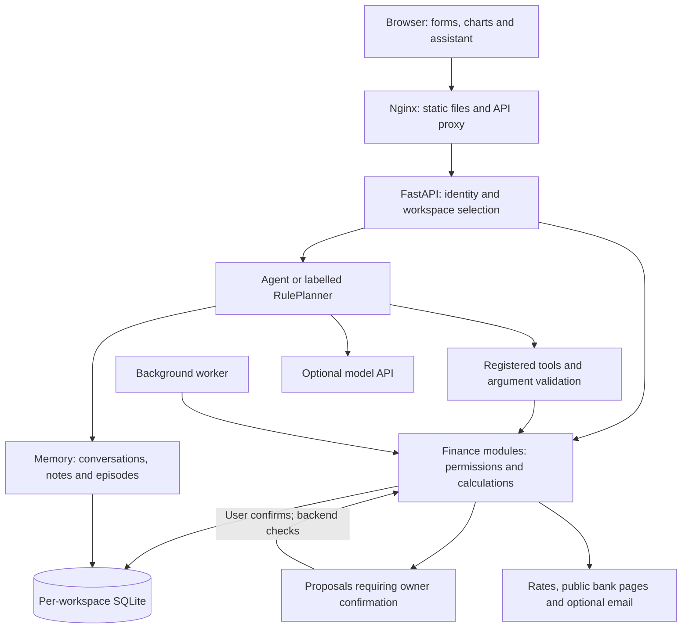

# DOT — Cross-border & Student Finance Assistant

**Team Dotopia · Topic C · Non-on-chain**

**English** | [简体中文](README.zh-CN.md)

**Repository:** https://github.com/ytan0008/dot-remittance-agent
**Access:** Public. Teachers can read or clone it without an invitation.

DOT helps international students and other cross-border users compare transfer costs, plan tuition funding, track spending and see how long their money will last. It connects exchange decisions with everyday budgets instead of treating them as separate tasks.

The AI reads information, calls finance tools, explains results and prepares changes. The backend checks permissions. Users confirm changes that require owner authority.

**The submitted application uses local simulations. It does not send bank transfers, move real funds or build a credit-bureau record.** Legacy EVM modules remain in the source for regression coverage, but are disabled in the documented deployment.


## 1. Start here

| What the submission contains | Where to find it |
|---|---|
| Backend and frontend source | [`finance/`](finance/), [`frontend/`](frontend/) |
| Docker deployment | [`compose.yaml`](compose.yaml), [`Dockerfile`](Dockerfile), [`frontend/Dockerfile`](frontend/Dockerfile) |
| Configuration templates | [Local HTTP](.env.example), [Public HTTPS](.env.competition.example) |
| Dependency versions | [`requirements.lock.txt`](requirements.lock.txt); supported ranges in [`requirements.txt`](requirements.txt) |
| Automated tests | [`tests/`](tests/), [dated verification record](docs/TEST-RESULTS.md) |
| Architecture, algorithms and security | [Technical documentation](docs/DOT-Technical-Documentation-EN.md), [security self-assessment](docs/DOT-Security-Self-Assessment-Report-v2.md) |
| Automated GitHub test runs | [Actions](https://github.com/ytan0008/dot-remittance-agent/actions) |

For marking, follow **Section 4** to start the application, **Section 6** for a walkthrough, and **Section 9** to reproduce the tests.

## 2. What DOT implements

| User need | Implemented behaviour | Boundary |
|---|---|---|
| “How should I send tuition money?” | Compare rates, fees, estimated arrival amounts and transfer scenarios; inspect bank fee evidence and save exchange plans. | Reference data and simulated quotes are labelled; they are not binding bank offers. |
| “Should I exchange now?” | Rate history, historical position, experimental seven-day forecasts, deadline-aware advice and reminders. | Forecasts can be wrong; baseline performance is disclosed. |
| “How much do I have across currencies?” | Enter or import balances, plan exchanges, identify currency gaps and explore future balances in a sandbox. | No live bank-account connection. Scenario balances are estimates. |
| “What did I spend this month?” | CSV import, receipt/screenshot reading, text entry, review queues, categories, duplicate hints and recurring expenses. | AI extraction needs a configured model and user review. |
| “Did I pay, or did my parents?” | Accounts and entries record who paid. Separate monthly budgets track the user's spending and spending paid by others. | Results depend on correct records and payer choices. |
| “Am I counting my credit-card repayment twice?” | Account and transaction types distinguish purchases, repayments and transfers between own accounts. | This is spending management, not credit reporting. |
| “Will my money last the term?” | Tuition dates, living costs, income, safety buffers, cash-flow forecasts and affordability checks. | User-entered plans are not verified income or bank balances. |
| “What about scholarships and bills?” | Scholarship applications and document checklists, bill deadlines, recurring entries and optional email digests. | Eligibility is not verified; email needs an external service. |
| “Can the assistant help me fill this in?” | Tool calls, result cards, detail forms, saved preferences and confirmation proposals. | There is one Agent orchestrator, not a distributed multi-agent system. |
| “Can I rehearse a transfer?” | Local draft → user approval → submission → reconciliation, with guardrails and audit history. | Simulation only; no external payment is sent. |

Other features include SWIFT/domestic transfer instruction templates, private progress milestones, dark/light themes and six interface languages: English, Simplified Chinese, Traditional Chinese, Japanese, Korean and Vietnamese. Templates validate formats, not account ownership. Voice input depends on browser support and microphone permission.

### A connected example

A student holds CNY and AUD, has tuition due next month and pays rent from an Australian account. They can compare an exchange, save the tuition funding plan, review card spending and check whether that plan leaves enough AUD for rent. The assistant can explain the calculation and prepare a change; it cannot turn a chat message into payment approval.

## 3. Architecture and Agent design



The backend is a **modular monolith**, served by one Uvicorn process. Docker runs a frontend container and a backend container. JavaScript ES modules are served directly; no Node.js build is required.

- **Tools:** declared in `finance/tools.py` with schemas and `view`/`prepare` tiers. The model cannot supply its own role. There is no model tool to approve or submit payments.
- **Memory:** conversations, durable notes and episode summaries in the user's workspace. Memory is context, never authority.
- **Calculations:** domain modules handle integer minor units, rate comparisons, budgets and cash flow. Model prose does not replace the ledger.
- **Confirmation:** selected tools may save permitted plans, pending records or memory directly. Owner-controlled actions use proposals and backend checks.
- **Fallback:** without a model key, a labelled rule-based planner supports common requests. It is not presented as an AI model.
- **Updates:** Server-Sent Events stream assistant progress and signal data changes to the browser.

## 4. Run locally with Docker

### Requirements

- Git, or download the repository ZIP and extract it.
- Docker Desktop using **Linux containers** on Windows/macOS, or Docker Engine with Compose v2 on Linux.
- Internet access for the first image/dependency download. Current rates, bank pages, model calls and email also need network access.
- Python 3.12 is recommended for local development. It is **not required on the host** if you use the Docker configuration command below.

The development machine uses Windows and PowerShell. The same Compose services run in Linux containers. Paths such as `E:\study\finance` are local choices, not required paths.

### Step 1 — Download

```bash
git clone https://github.com/ytan0008/dot-remittance-agent.git
cd dot-remittance-agent
```

### Step 2 — Create local configuration

With Python installed:

```bash
python scripts/configure.py
```

Or with Docker only, from PowerShell or a POSIX shell:

```bash
docker run --rm -v "${PWD}:/workspace" -w /workspace python:3.12-slim python scripts/configure.py
```

The script creates `.env`, generates distinct random owner/agent tokens, and leaves the model key blank. It replaces blank/example tokens but preserves other existing values. **It does not reset an old deployment:** if `.env` already exists, check the settings below before continuing.

For a local HTTP demonstration:

```dotenv
PUBLIC_DEPLOY=false
COOKIE_SECURE=false
ENABLE_ONCHAIN=false
ENABLE_LIVE_PAYMENTS=false
EVM_RPC_URL=
ENABLE_DEMO_LOGIN=true
ALLOW_SIGNUP=true
ENABLE_WORKER=true
FRONTEND_PORT=8787
```

Keep the generated `OWNER_TOKEN` and `AGENT_TOKEN` in `.env`. They must be different and at least 24 characters long. Do not paste them into chat or commit them.

### Step 3 — Build and start

```bash
docker compose up -d --build
docker compose ps
```

Wait until the backend is healthy. Open **http://localhost:8787**.

- Health: http://localhost:8787/api/health
- API documentation: http://localhost:8787/api/docs
- OpenAPI schema: http://localhost:8787/api/openapi.json

Choose **Try the demo** for a temporary workspace, or register an account for persistent records. Registration creates a separate workspace. Access to pre-existing default-workspace data requires an explicit owner-token claim.

Demo workspaces are temporary: they are cleaned up after 24 hours and at backend startup. Do not use a demo session to store work you need to retain.

### Step 4 — Check, update and stop

```bash
docker compose logs --tail 100 backend
docker compose logs --tail 100 frontend
docker compose up -d --build
docker compose down
```

Rebuild after source changes. After `.env` changes, run `docker compose up -d --force-recreate`; restarting an existing container does not load new environment values.

`docker compose down` preserves the database volume. **Do not add `-v` unless you intend to delete stored application data.**

## 5. Environment configuration

Docker Compose reads `.env` and passes it to the backend. It overrides `FINANCE_DB` to `/app/data/finance.sqlite3`, stored in the named `finance_data` volume. The frontend binds to `127.0.0.1`; the backend is not published as a host port.

| Variable | Purpose / local value |
|---|---|
| `OWNER_TOKEN`, `AGENT_TOKEN` | Required, distinct API credentials, at least 24 characters. Generated by the setup script. They are not ordinary user passwords. |
| `VIEWER_TOKEN` | Optional read-only API credential; distinct and 24+ characters if enabled. |
| `FRONTEND_PORT` | Host port; default `8787`. |
| `FINANCE_DB` | Python-only path; Compose uses `/app/data/finance.sqlite3`. |
| `ALLOW_SIGNUP` | `true` allows registration; `false` closes ordinary registration. |
| `ENABLE_DEMO_LOGIN` | `true` shows the temporary demo entry. |
| `PUBLIC_DEPLOY` | Local HTTP: `false`. Public deployment: `true`, forcing Secure cookies and refusing on-chain/live-payment configuration. |
| `COOKIE_SECURE` | Local HTTP: `false`. HTTPS: `true`. Public mode forces Secure cookies regardless of this setting. |
| `ENABLE_WORKER` | `true` enables reconciliation, reminders and scheduled checks. |
| `SANDBOX_SETTLE_SECONDS` | Simulated settlement delay; default `8`. |
| `ENABLE_ONCHAIN`, `ENABLE_LIVE_PAYMENTS`, `EVM_RPC_URL` | Keep `false`, `false`, empty for this submission. |
| `MAX_PAYMENT_AUD`, `DAILY_PAYMENT_AUD` | Initial sandbox guardrail values; template defaults `500` and `1000`. |
| `OPENAI_API_KEY` | Optional model credential. Blank enables the rule planner. |
| `OPENAI_MODEL` | Model identifier accepted by your configured provider. The template contains the project's development default, not a guarantee of account access. |
| `OPENAI_BASE_URL` | Blank uses the SDK default; otherwise the provider's compatible API base, typically ending in `/v1`. |
| `OPENAI_REASONING_EFFORT` | Provider/model-specific setting; template value `none`. Check compatibility with your chosen model. |
| `RESEND_API_KEY`, `RESEND_FROM` | Optional email provider key and allowed sender. Resend takes priority over SMTP. |
| `SMTP_HOST`, `SMTP_PORT`, `SMTP_SECURITY` | Optional SMTP host, port (`587`) and mode (`starttls`; use `ssl` for implicit TLS). |
| `SMTP_USER`, `SMTP_PASSWORD`, `SMTP_FROM` | SMTP credentials and permitted sender. |

### Model and receipt setup

Use a Chat Completions-compatible endpoint with tool calling. Receipt/image extraction also requires image input support. Add your own key and model identifier to `.env`, then recreate the backend:

```bash
docker compose up -d --force-recreate backend
```

No model key is included in this repository. Model requests can incur provider charges. Text redaction runs before model calls; receipt images can be manually masked in the browser before upload. Users should review what remains visible.

Without a key, forms, CSV review, budgets, cash-flow calculations, sandbox workflows and supported rule-planner requests remain usable. Current rates and public-page retrieval still need internet access; “rule-based” does not mean the whole application works offline.

### Email setup

Configure either Resend or SMTP, recreate the backend, then choose the destination and digest schedule in the application. Keep `ENABLE_WORKER=true`. Without a sender service, reports can be previewed but are not delivered.

### Public HTTPS deployment

The provided Compose file is a **local deployment**, not a complete public hosting setup. For a hosted demonstration:

1. Put an HTTPS reverse proxy in front of the loopback frontend port and configure the domain/certificate.
2. Use `.env.competition.example` as the configuration reference; generate your own tokens.
3. Set `PUBLIC_DEPLOY=true`, `COOKIE_SECURE=true`, `ENABLE_ONCHAIN=false`, `ENABLE_LIVE_PAYMENTS=false`, and leave `EVM_RPC_URL` empty.
4. Preserve the host/proxy configuration and SSE streaming; test sign-in and long assistant responses through the public URL.
5. Restrict host access, encrypt storage/backups and test a restore. Decide whether registration and demo access should remain enabled.

Do not use the public template for plain HTTP and then disable cookie protection to work around failed login. Use the local template for local HTTP.

## 6. Suggested teacher walkthrough

Use fictional data in a demo workspace:

1. Switch the interface to **English**.
2. Enter balances such as AUD 6,200 and CNY 18,000.
3. Add a term with tuition, a due date, monthly income and living costs.
4. Compare a CNY/AUD exchange and save an exchange plan.
5. Import a sample CSV or enter expenses, review the entries and set a monthly budget.
6. Open the sandbox and term cash flow to inspect the effect of tuition and spending.
7. Ask the assistant about the plan. Check the visible rule/model label.
8. Inspect memory and audit records. For payment simulation, add sandbox funds and a fictional recipient, then prepare, approve and submit a small simulated payment.

Adding a cash balance for planning and funding a simulated-payment balance are different operations. Use the sandbox controls when testing simulated payments.

## 7. Repository map

```text
finance/
  api.py, web.py           API and standalone development server
  agent.py, agent_rules.py Agent orchestration and rule fallback
  tools.py, actions.py     Tool registry and confirmable actions
  service.py, domain.py    Finance service, permissions and money types
  rates.py, banks.py       Reference rates and bank fee evidence
  bank_kb.py, watch.py     Bank knowledge base and exchange monitoring
  plans.py, planning.py    Plans, comparisons and proposals
  expenses.py, student.py  Spending, tuition and cash flow
  memory.py, privacy.py    Context storage and redaction
  auth.py, store.py        Accounts, sessions, SQLite and audit records
  worker.py, mailer.py     Background processing and optional email
frontend/
  dist/                   Served HTML, CSS and JavaScript modules
  nginx.conf              API proxy, SSE and security headers
tests/                    Unit, integration, regression and security cases
  browser/                Playwright smoke/layout scripts and demo recording tools
scripts/configure.py      Local configuration bootstrap
scripts/evidence_report.py Exported demo evidence → readable reports
docs/                     Technical, security and verification documentation
.github/workflows/         Automated test execution
```

`data/`, `.env`, `artifacts/` and `outputs/` are local runtime/generated files and are not part of the source submission.

## 8. Run without Docker (development)

Use Python **3.12** and the locked dependencies. No npm installation is needed.

PowerShell:

```powershell
python -m venv .venv
.\.venv\Scripts\python -m pip install -r requirements.lock.txt
.\.venv\Scripts\python scripts/configure.py
# Load simple KEY=value lines from the locally generated .env without printing values.
Get-Content .env | ForEach-Object {
    if ($_ -match '^\s*([A-Za-z_][A-Za-z0-9_]*)=(.*)$') {
        [Environment]::SetEnvironmentVariable($matches[1], $matches[2], 'Process')
    }
}
.\.venv\Scripts\python -m uvicorn finance.web:app --host 127.0.0.1 --port 8787 --workers 1
```

macOS/Linux:

```bash
python3.12 -m venv .venv
.venv/bin/python -m pip install -r requirements.lock.txt
.venv/bin/python scripts/configure.py
set -a
. ./.env
set +a
.venv/bin/python -m uvicorn finance.web:app --host 127.0.0.1 --port 8787 --workers 1
```

Only source your own trusted `.env`; quote shell-special characters when editing it for shell use. The PowerShell loader above is for the generated simple format, not a general dotenv parser. Stop the server with Ctrl+C. The standalone server is for development; it does not reproduce Nginx's deployment headers.

## 9. Test cases and results

See [TEST-RESULTS.md](docs/TEST-RESULTS.md) for the dated run, counts and scope. Counts are not added across overlapping security suites. A green test suite is not a security certification.

**Verified on 21 October 2026:** 425 tests passed on Windows and 425 passed in the Linux Docker image, with no failures or skips. Browser smoke and the 13-view × 6-language × desktop/mobile sweep also passed.

### Full Python suite

PowerShell:

```powershell
.\.venv\Scripts\python -m pytest tests -q --junitxml=artifacts/test-results.xml
```

macOS/Linux:

```bash
.venv/bin/python -m pytest tests -q --junitxml=artifacts/test-results.xml
```

Docker, using the built backend image and a temporary database location:

```bash
docker compose run --rm --no-deps -e FINANCE_DB=/tmp/dot-tests.sqlite3 -e ENABLE_WORKER=false backend python -m pytest tests -q
```

Tests use temporary workspaces, fixed reference rates and scripted model responses. Legacy EVM tests use an in-process Ethereum tester, not a real chain or funded wallet. No model key is required for the Python suite.

### Focused tests and offline simulation

```bash
python -m pytest tests/test_hardening.py tests/test_configure.py -q
python -m finance.demo
```

Run these with the virtual environment's Python. `finance.demo` creates a temporary database and demonstrates permission denial, owner approval, idempotency and recovery.

### Browser acceptance (optional, slower)

Start the local Docker application with demo access and the worker enabled, then:

```bash
docker build -f tests/browser/Dockerfile -t remittance-agent-browser-test .
docker run --rm --network remittance-agent_default -v "${PWD}/artifacts:/artifacts" remittance-agent-browser-test
```

Create the `artifacts` directory first (`New-Item -ItemType Directory -Force artifacts` in PowerShell; `mkdir -p artifacts` on macOS/Linux). The default network follows the Compose project name `remittance-agent`; adjust it if you use `docker compose -p`.

The image runs `smoke.py` and `layout.py`: a simulated payment flow plus page/language/viewport checks. These tests depend on a running application and some network-backed data. Browser test success is reported separately from Python test results.

The `demo_video.py`, `demo_full.py` and `scripts/evidence_report.py` utilities are optional recording/evidence tools. Narrated video generation has additional media/TTS dependencies described in the script; it is not needed to run or grade DOT.

## 10. Security and scope

- Roles are enforced by the backend, including owner-only confirmations.
- Accounts have separate workspaces; sessions and lockouts persist in the account database. Session tokens are stored as hashes.
- Mixed session/Bearer credentials are rejected.
- Proposal claims prevent concurrent confirmation from executing the same proposal twice. Interrupted proposals require inspection; this is not a claim of global exactly-once processing across all failures.
- Text redaction, optional image masking, source checks and DNS-pinned fetching reduce exposure to untrusted inputs.
- Audit entries have a hash chain. Host-level access could still replace data and its chain unless an external trusted checkpoint is used.
- Public mode refuses on-chain/live-payment settings. A user-configured automatic FX rule changes **local simulation balances only**.

The project does not provide live bank integration, credit scoring, guaranteed exchange forecasts or a claim of regulatory certification. Live-model adversarial evaluation, production load testing, dependency scanning and host-level encryption remain separate work. See the [security report](docs/DOT-Security-Self-Assessment-Report-v2.md).

## 11. Troubleshooting

| Symptom | Check |
|---|---|
| Backend exits immediately | Distinct owner/agent tokens of 24+ characters; inspect backend logs. |
| Login does not persist on local HTTP | Use local settings: `PUBLIC_DEPLOY=false`, `COOKIE_SECURE=false`; recreate the backend. |
| Port 8787 is occupied | Change `FRONTEND_PORT` in `.env` and recreate the frontend. |
| Assistant says rule-based | Model key is blank, or the model path is unavailable; check model/endpoint compatibility and logs. |
| Receipt reading is unavailable | Configure an image-capable model; manual entry and CSV remain available. |
| No current rates | Check outbound network access and source availability; DOT does not invent missing reference data. |
| Payment stays pending; no reminders | Ensure the worker is enabled and allow time for simulated settlement. |
| Demo records disappeared | Demo workspaces are temporary and removed at restart; register for persistent work. |
| API docs assets do not load | Swagger UI uses external CDN assets; inspect `/api/openapi.json` if the CDN is unavailable. |
| Tests cannot import dependencies | Use Python 3.12 and install `requirements.lock.txt` in the selected virtual environment. |

## 12. Submit or download a fixed source version

Share the repository link together with the submitted commit ID:

```bash
git rev-parse HEAD
git archive --format=zip --output=dot-source.zip HEAD
```

The ZIP contains tracked source at that commit, including README files, deployment configuration and tests. It excludes local secrets and generated runtime data. Teachers can also use GitHub's **Code → Download ZIP**; the branch ZIP follows the current branch, so use a commit link when a fixed version matters.
