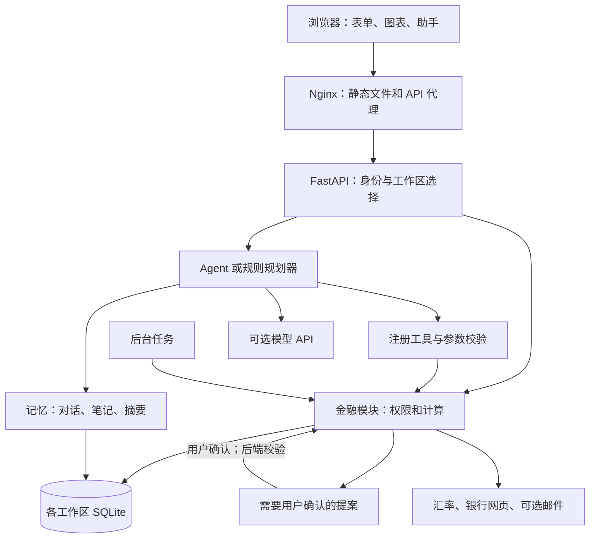

# DOT — 跨境与留学生 AI 金融助手

**Dotopia 团队 · Topic C · Non-on-chain**

[English](README.md) | **简体中文**

**GitHub 仓库：** https://github.com/ytan0008/dot-remittance-agent
**访问方式：** 公开仓库，老师无需邀请即可查看和下载。

DOT 帮助留学生及跨境用户比较汇款成本、安排学费资金、整理日常开销，并了解现有资金能支撑多久。它把换汇计划、学费和生活预算联系起来，让用户看到一次资金安排对后续生活的影响。

AI 负责理解需求、调用金融工具、解释计算结果和准备修改。后端负责校验权限；需要 Owner 权限的修改由用户确认。

**本项目提交的是本地模拟版本，不发送银行汇款，不转移真实资金，也不形成征信记录。** 仓库保留了旧版 EVM 模块和回归测试，但本说明中的部署方式关闭链上功能。


## 1. 提交材料在哪里

| 材料 | 路径 |
|---|---|
| 前后端源码 | [`finance/`](finance/)、[`frontend/`](frontend/) |
| Docker 部署配置 | [`compose.yaml`](compose.yaml)、根目录和前端的 Dockerfile |
| 环境变量模板 | [本地 HTTP](.env.example)、[公网 HTTPS](.env.competition.example) |
| 固定依赖版本 | [`requirements.lock.txt`](requirements.lock.txt) |
| 测试代码与结果 | [`tests/`](tests/)、[带日期的验证记录](docs/TEST-RESULTS.md) |
| 技术与安全文档 | [技术文档](docs/DOT-Technical-Documentation-EN.md)、[安全自评](docs/DOT-Security-Self-Assessment-Report-v2.md) |
| GitHub 自动测试 | [Actions](https://github.com/ytan0008/dot-remittance-agent/actions) |

建议老师依次阅读：**第 4 节启动 → 第 6 节体验 → 第 9 节运行测试**。

## 2. 项目实现了什么

| 用户问题 | 已实现功能 | 功能边界 |
|---|---|---|
| 学费怎么汇更合适？ | 汇率、手续费、预计到账额及汇款情景比较；银行费用证据；换汇计划。 | 参考数据和模拟报价有标签，不是银行最终承诺。 |
| 现在适合换汇吗？ | 历史位置、实验性七日预测、结合截止日的建议及提醒。 | 不保证预测正确；会显示与基线的比较。 |
| 多个币种的钱够不够？ | 手动或导入余额、换汇计划、分币种缺口、未来余额沙盒。 | 没有直接连接真实银行账户。 |
| 这个月花了多少？ | CSV 导入、小票/截图识别、文字记账、分类、重复提示、周期支出和审核队列。 | 图片识别需要模型；提取结果需要检查。 |
| 是我付的钱，还是家长付的？ | 账户和账目记录付款人；本人支出和他人代付分别设置月预算。 | 依赖付款人及账目填写准确。 |
| 信用卡还款会重复算支出吗？ | 区分消费、还款和自己账户之间的转账。 | 是开销管理，不是信用评分。 |
| 资金能撑完整个学期吗？ | 学费到期日、生活费、收入、安全缓冲、现金流预测和购买能力检查。 | 基于用户填写的计划，不验证真实收入或银行余额。 |
| 奖学金、账单怎么跟进？ | 奖学金申请状态和材料清单、账单提醒、周期支出、可选邮件摘要。 | 不验证申请资格；邮件需要外部服务。 |
| AI 能帮我填信息吗？ | 工具调用、结果卡片、补充信息表单、偏好记忆和待确认提案。 | 一个主 Agent 调用业务模块，不是分布式多 Agent。 |
| 能演练一次汇款吗？ | 本地草稿、用户授权、提交、对账及审计记录。 | 只修改模拟数据，不发送外部付款。 |

还包括 SWIFT 和多种国内转账格式模板、个人成长记录、明暗主题，以及英、简中、繁中、日、韩、越六种界面语言。银行模板校验字段格式，不证明账户属于收款人。语音输入取决于浏览器支持和麦克风权限。

例如，一位学生持有人民币和澳元，下月需要交学费，也要从澳元账户支付房租。DOT 可以比较换汇方案、保存学费资金计划、整理卡片消费，再检查剩余澳元是否覆盖房租。AI 可以解释结果，但不能把聊天中的“同意”当作支付授权。

## 3. 系统架构



后端是**模块化单体应用**，使用一个 Uvicorn 进程。Docker 分别运行前端和后端容器。前端是直接提供的 JavaScript ES modules，无需 Node.js 构建。

- **Tools：** `finance/tools.py` 定义工具、参数及 `view`/`prepare` 分级。模型不能自己指定调用角色，也没有批准或提交支付的工具。
- **Memory：** 在工作区内保存对话、笔记和摘要。记忆不能证明余额，也不能赋予权限。
- **金融计算：** 业务模块负责最小货币单位整数计算、汇率比较、预算及现金流。模型文字不代替账本。
- **用户确认：** 某些工具可直接保存允许的计划、待审核记录或记忆；需要 Owner 权限的操作使用提案和后端检查。
- **降级模式：** 没有模型 Key 时，明确标注的规则规划器处理支持的请求，不冒充模型。
- **动态更新：** SSE 推送助手进度和数据变更信号。

## 4. Docker 本地启动

### 环境要求

- Git；也可以下载 ZIP 后解压。
- Windows/macOS 使用 Docker Desktop，并启用 **Linux containers**；Linux 使用 Docker Engine 和 Compose v2。
- 首次下载镜像和依赖需要网络。实时参考汇率、银行网页、模型及邮件也需要网络。
- 本地开发建议 Python 3.12；如果使用下面的 Docker 配置命令，宿主机不必安装 Python。

开发环境为 Windows + PowerShell，应用运行在 Linux 容器中。`E:\study\finance` 只是开发者的本机目录，老师可以放在任意目录。

### 第一步：下载代码

```bash
git clone https://github.com/ytan0008/dot-remittance-agent.git
cd dot-remittance-agent
```

### 第二步：生成配置

已安装 Python：

```bash
python scripts/configure.py
```

只有 Docker 时，PowerShell 或 macOS/Linux shell 均可执行：

```bash
docker run --rm -v "${PWD}:/workspace" -w /workspace python:3.12-slim python scripts/configure.py
```

脚本创建 `.env`，生成两个不同的随机令牌，模型 Key 留空。它会替换空白或示例令牌，保留其他已有设置。**它不会重置旧环境**：已有 `.env` 时，请检查下面这些值。

```dotenv
PUBLIC_DEPLOY=false
COOKIE_SECURE=false
ENABLE_ONCHAIN=false
ENABLE_LIVE_PAYMENTS=false
EVM_RPC_URL=
ENABLE_DEMO_LOGIN=true
ALLOW_SIGNUP=true
ENABLE_WORKER=true
FRONTEND_PORT=8787
```

保留脚本生成的 `OWNER_TOKEN` 和 `AGENT_TOKEN`，两者必须不同且至少 24 个字符。不要放进聊天或提交到仓库。

### 第三步：启动

```bash
docker compose up -d --build
docker compose ps
```

后端变为 healthy 后，打开 **http://localhost:8787**。

- 健康检查：http://localhost:8787/api/health
- API 文档：http://localhost:8787/api/docs
- OpenAPI：http://localhost:8787/api/openapi.json

点击 **Try the demo** 进入临时工作区；注册账户可以持久保存数据。注册会创建独立工作区，首次注册不会自动获得原有数据。接管默认工作区必须明确提供 Owner Token。

演示工作区会在 24 小时后及后端启动时清理。需要保留的数据请使用注册账户。

### 第四步：日志、更新与停止

```bash
docker compose logs --tail 100 backend
docker compose logs --tail 100 frontend
docker compose up -d --build
docker compose down
```

修改代码后重新构建。修改 `.env` 后执行 `docker compose up -d --force-recreate`；单纯 restart 不会更新容器的环境变量。

`docker compose down` 保留数据库卷。**除非确定要删除应用数据，否则不要加 `-v`。**

## 5. 环境变量怎么配

Compose 自动读取 `.env`，并把后端 `FINANCE_DB` 覆盖为 `/app/data/finance.sqlite3`，数据存放在命名卷 `finance_data` 中。前端默认只绑定 `127.0.0.1`；后端端口不直接暴露给宿主机。

| 变量 | 用途与本地设置 |
|---|---|
| `OWNER_TOKEN`、`AGENT_TOKEN` | 必填且不同，至少 24 字符；由脚本生成。不是普通用户登录密码。 |
| `VIEWER_TOKEN` | 可选只读 API 凭据；启用时也要独立且至少 24 字符。 |
| `FRONTEND_PORT` | 浏览器端口，默认 `8787`。 |
| `FINANCE_DB` | 直接运行 Python 时的路径；Compose 中使用固定的容器路径。 |
| `ALLOW_SIGNUP` | 是否允许普通用户注册。 |
| `ENABLE_DEMO_LOGIN` | 是否开放临时演示入口。 |
| `PUBLIC_DEPLOY` | 本地 HTTP 为 `false`；公网为 `true`，强制 Secure Cookie，并拒绝链上/真实支付配置。 |
| `COOKIE_SECURE` | 本地 HTTP 为 `false`；HTTPS 为 `true`。公网模式无论此值如何都会强制开启。 |
| `ENABLE_WORKER` | 启用模拟支付对账、提醒和定时检查。 |
| `SANDBOX_SETTLE_SECONDS` | 模拟支付结算等待秒数，默认 `8`。 |
| `ENABLE_ONCHAIN`、`ENABLE_LIVE_PAYMENTS`、`EVM_RPC_URL` | 本提交保持 `false`、`false`、空。 |
| `MAX_PAYMENT_AUD`、`DAILY_PAYMENT_AUD` | 初始模拟支付限额；模板默认 `500`、`1000`。 |
| `OPENAI_API_KEY` | 可选模型密钥；空值启用规则规划器。 |
| `OPENAI_MODEL` | 服务商和你的账户支持的模型标识。模板只是开发默认值，不保证所有账户都有权限。 |
| `OPENAI_BASE_URL` | 空值使用 SDK 默认地址；其他兼容服务填写 API base，通常以 `/v1` 结尾。 |
| `OPENAI_REASONING_EFFORT` | 模型相关参数，模板为 `none`；需与你选用的模型兼容。 |
| `RESEND_API_KEY`、`RESEND_FROM` | 可选邮件密钥和允许的发件地址；优先于 SMTP。 |
| `SMTP_HOST`、`SMTP_PORT`、`SMTP_SECURITY` | SMTP 主机、端口及 TLS 方式；模板为 `587` / `starttls`。 |
| `SMTP_USER`、`SMTP_PASSWORD`、`SMTP_FROM` | SMTP 登录信息及允许的发件地址。 |

### 配置真实 AI 与图片识别

使用支持 Chat Completions 和 tool calling 的兼容接口。识别小票还需要模型支持图片输入。在本机 `.env` 填入密钥、模型标识和必要的接口地址，然后：

```bash
docker compose up -d --force-recreate backend
```

仓库不提供真实 API Key。调用可能产生服务商费用。模型调用前会做文本脱敏；上传图片前，用户可以在浏览器中手动遮盖敏感区域，并检查仍然可见的信息。

没有 Key 时，表单、CSV 审核、预算、现金流、沙盒及规则规划器支持的请求仍可使用。实时汇率和网页读取仍需要联网，“规则模式”不等于整个应用离线可用。

### 邮件

配置 Resend 或 SMTP 后重建后端，再到应用中设置接收地址、摘要周期和提醒。保持 `ENABLE_WORKER=true`。没有邮件服务时可以预览报告，但不能发信。

### 公网 HTTPS

默认 Compose 是本地部署，不包含完整公网托管：

1. 在本机回环端口前配置 HTTPS 反向代理、域名和证书。
2. 参考 `.env.competition.example`，使用自己生成的随机令牌。
3. 设置 `PUBLIC_DEPLOY=true`、`COOKIE_SECURE=true`，关闭链上和真实支付，清空 RPC 地址。
4. 检查代理 Host、协议设置和 SSE 流式转发，并从公网 URL 验证登录。
5. 限制服务器访问，配置磁盘/备份加密并验证恢复；决定是否开放注册和演示。

不要拿公网模板启动纯 HTTP 后，再通过关闭保护来修复登录。本地 HTTP 请用本地模板。

## 6. 给老师的体验顺序

在演示空间中使用虚构数据：

1. 将语言切换为 English。
2. 输入余额，例如 AUD 6,200 和 CNY 18,000。
3. 创建学期，填写学费、截止日期、月收入和生活费。
4. 比较 CNY/AUD 换汇，保存资金计划。
5. 导入示例 CSV 或手动记账，审核后设置月预算。
6. 查看沙盒和学期现金流，观察资金缺口。
7. 向助手询问计划，注意界面显示的是模型还是规则模式。
8. 查看记忆和审计。如需体验模拟支付，先添加测试资金及虚构收款人，再完成草稿、授权和提交。

规划余额与模拟支付资金是不同数据；要演示支付，请使用沙盒的资金操作。

## 7. 目录说明

```text
finance/
  api.py, web.py           API 与独立开发服务器
  agent.py, agent_rules.py Agent 编排与规则降级
  tools.py, actions.py     工具注册与待确认操作
  service.py, domain.py    服务、权限和金额类型
  rates.py, banks.py       汇率与银行费用证据
  bank_kb.py, watch.py     银行知识库与换汇监测
  plans.py, planning.py    计划、比较和提案
  expenses.py, student.py  支出、学费和现金流
  memory.py, privacy.py    记忆和脱敏
  auth.py, store.py        账户、会话、数据库和审计
  worker.py, mailer.py     后台任务与邮件
frontend/
  dist/                   HTML、CSS、JavaScript
  nginx.conf              API 代理、SSE 和安全响应头
tests/                    单元、集成、回归和安全测试
  browser/                浏览器验收及演示录制工具
scripts/configure.py      环境配置脚本
scripts/evidence_report.py 演示证据转报告
docs/                     技术、安全及验证文档
.github/workflows/         自动测试
```

`.env`、`data/`、`artifacts/`、`outputs/` 属于本地配置、数据或生成文件，不是源码提交内容。

## 8. 不使用 Docker 的开发方式

使用 Python **3.12** 和锁定依赖，不需要 npm。

PowerShell：

```powershell
python -m venv .venv
.\.venv\Scripts\python -m pip install -r requirements.lock.txt
.\.venv\Scripts\python scripts/configure.py
# 读取本机生成的简单 KEY=value 配置，不打印值。
Get-Content .env | ForEach-Object {
    if ($_ -match '^\s*([A-Za-z_][A-Za-z0-9_]*)=(.*)$') {
        [Environment]::SetEnvironmentVariable($matches[1], $matches[2], 'Process')
    }
}
.\.venv\Scripts\python -m uvicorn finance.web:app --host 127.0.0.1 --port 8787 --workers 1
```

macOS/Linux：

```bash
python3.12 -m venv .venv
.venv/bin/python -m pip install -r requirements.lock.txt
.venv/bin/python scripts/configure.py
set -a
. ./.env
set +a
.venv/bin/python -m uvicorn finance.web:app --host 127.0.0.1 --port 8787 --workers 1
```

只 source 自己可信的配置文件；使用 shell 时含特殊字符的值应正确加引号。PowerShell 示例读取脚本生成的简单格式，不是通用 dotenv 解析器。Ctrl+C 停止服务。独立服务器用于开发，不包含 Nginx 的部署响应头。

## 9. 测试与结果

[测试记录](docs/TEST-RESULTS.md) 提供实际执行日期、数量和范围。安全用例已包含在完整测试中，不重复累加。通过测试不等于安全认证。

**2026 年 10 月 21 日验证：** Windows 与 Linux Docker 均为 425 项通过，0 失败、0 跳过。浏览器模拟支付及 13 页面 × 6 语言 × 桌面/手机巡检也已通过。

PowerShell：

```powershell
.\.venv\Scripts\python -m pytest tests -q --junitxml=artifacts/test-results.xml
```

macOS/Linux：

```bash
.venv/bin/python -m pytest tests -q --junitxml=artifacts/test-results.xml
```

已构建镜像时也可以直接用 Docker：

```bash
docker compose run --rm --no-deps -e FINANCE_DB=/tmp/dot-tests.sqlite3 -e ENABLE_WORKER=false backend python -m pytest tests -q
```

测试使用临时工作区、固定汇率和脚本模型。旧版 EVM 测试在进程内模拟链上运行，不连接真实链，不需要真实资金。Python 测试不需要模型 Key。

专项测试和离线模拟，用虚拟环境中的 Python 执行：

```bash
python -m pytest tests/test_hardening.py tests/test_configure.py -q
python -m finance.demo
```

`finance.demo` 使用临时数据库演示权限拒绝、用户授权、幂等提交和异常恢复。

### 浏览器验收（可选，耗时更长）

先启动本地 Docker 应用，开启演示入口和后台任务。创建 `artifacts` 目录：PowerShell 使用 `New-Item -ItemType Directory -Force artifacts`；macOS/Linux 使用 `mkdir -p artifacts`。

```bash
docker build -f tests/browser/Dockerfile -t remittance-agent-browser-test .
docker run --rm --network remittance-agent_default -v "${PWD}/artifacts:/artifacts" remittance-agent-browser-test
```

默认网络名来自 Compose 的 `remittance-agent` 项目名；使用 `-p` 时需调整。镜像运行 `smoke.py` 和 `layout.py`，验证模拟支付流程及页面、语言、视口。它依赖运行中的应用和部分网络数据，结果与 Python 测试分别记录。

`demo_video.py`、`demo_full.py` 和 `scripts/evidence_report.py` 是可选录制/证据工具。带配音视频需要额外的媒体及 TTS 依赖，详见脚本；老师运行和评审应用不需要它们。

## 10. 安全设计与边界

- 后端执行角色检查，限制确认和支付授权。
- 各账户独立工作区；会话和锁定记录持久化，会话令牌仅保存哈希。
- 同时带会话和 Bearer 凭据的请求会被拒绝。
- 提案使用原子占用，防止并发确认重复执行；中断提案需要检查，不宣称所有失败场景都实现全局 exactly-once。
- 文本脱敏、可选图片遮盖、来源证据校验和 DNS 固定降低外部数据风险。
- 审计有哈希链；没有外部可信检查点时，不能抵抗主机管理员同时改写数据和链。
- 公网模式禁止链上/真实支付。用户预设的自动换汇规则只改变**本地模拟余额**。

不提供真实银行接入、征信评分、保证准确的预测或监管认证。真实模型对抗评估、生产负载测试、依赖扫描和主机加密仍需分别完成。详细内容见[安全报告](docs/DOT-Security-Self-Assessment-Report-v2.md)。

## 11. 常见问题

| 问题 | 检查方式 |
|---|---|
| 后端启动就退出 | 检查两个令牌不同且至少 24 字符，查看 backend 日志。 |
| 本地 HTTP 登录后仍退出 | 检查 `PUBLIC_DEPLOY=false`、`COOKIE_SECURE=false`，然后重建容器。 |
| 8787 被占用 | 修改 `FRONTEND_PORT`，重新创建前端容器。 |
| 助手显示规则模式 | Key 留空或模型不可用；检查模型标识、接口兼容性和日志。 |
| 图片识别不可用 | 使用支持图像的模型；可以先用手动记账或 CSV。 |
| 无法获取汇率 | 检查网络和数据源；系统不会编造缺失数据。 |
| 支付不结算、提醒不更新 | 检查后台任务已开启，等待模拟结算。 |
| 演示数据消失 | 演示空间会过期或在重启时清理；持久数据请用注册账户。 |
| API 文档样式加载失败 | Swagger 使用外部 CDN；可直接查看 OpenAPI JSON。 |
| 测试缺少依赖 | 确认使用 Python 3.12，并在对应虚拟环境安装 lock 文件。 |

## 12. 提交固定版本

把仓库链接和提交哈希一起发给老师：

```bash
git rev-parse HEAD
git archive --format=zip --output=dot-source.zip HEAD
```

ZIP 包含该提交的源码、README、部署文件和测试，不包含未跟踪的本机密钥和运行数据。GitHub 的 **Code → Download ZIP** 也可下载，但分支会继续更新，需要固定版本时请提供 commit 链接。
