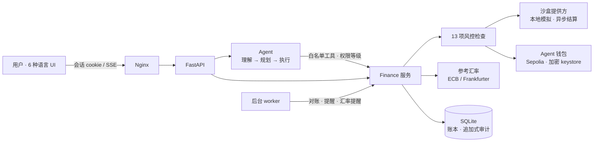

<div align="center">

[English](README.md) · **简体中文**

# ◉ DOT · AI 跨境汇款助手

**一个会「理解 · 规划 · 安全执行」的金融 Agent —— 拥有自己的链上钱包，只在你划定的边界内花钱。**

     


</div>

---

## 这是什么

跨境汇款时，人们要同时考虑汇率、手续费、可用资金、收款人和到账时间。**参考汇率算出的金额 ≠ 扣费后真正到账的金额**，最低手续费也不一定到账最多。

DOT 是一个自然语言 AI Agent，帮你：

- 🔍 **看懂汇率**：真实的 ECB 日参考汇率，带来源与时间；按你的汇款方向解读历史高低位
- ⚖️ **比较方案**：参考计算、模拟方案、沙盒报价三者严格区分，按到账金额或速度排序
- 📝 **准备支付**：固定发送额，或按“对方要收到多少”反算
- 🛡️ **安全执行**：13 项风控检查 + 你的明确授权，Agent 永远不能批准自己的支付
- ⛓️ **链上自主花钱**：Agent 拥有自己的加密钱包，在你授予的预授权（固定收款人、单笔上限、总预算、期限）内自主签名转账
- 🧾 **全程可追溯**：谁授权了什么、跑了哪些检查、之后发生了什么，一条审计轨迹全部回答

> 本项目实现了课程/产品文档《AI Cross-Border Remittance Assistant》v4.0 中的全部功能模块（4.1–4.15），对照表见[下文](#-文档需求对照)。

---

## ✨ 亮点

### 1. 理解 → 规划 → 执行，每一步都看得见

Agent 每轮对话先调用 `record_plan` 记录**意图、提取的金额币种收款人、缺失信息、计划步骤**，再按权限等级调用工具。三个阶段通过 SSE 实时流式呈现，工具结果以卡片展示（汇率、比较、草稿、链上状态），并标注数据类型——参考数据、模拟、账本记录还是链上状态。


- 未配置大模型时，由**离线规则规划器**驱动同一条流水线（明确标注“不是 AI”），支持 6 种语言的常见意图，缺信息会追问并在下一句补全
- 配置任意 **OpenAI 兼容**、支持 function calling 的模型后即为真 AI
- 模型工具里**没有**“批准”“授予预授权”“提高额度”——说“好的”永远不等于授权

### 2. 先比较，再汇款


输入金额实时比较：参考汇率基准、三种模拟方案（银行电汇 / 在线汇款 / 即时取现）与可执行的沙盒报价，列出固定费、百分比费、适用汇率、价差、时效、较参考损失和**未包含的费用**。

### 3. 授权必须是一个刻意的动作


授权屏显示环境标签、精确金额、费率来源、报价倒计时、状态时间线和逐项风控检查。勾选确认后需要**长按圆环**才能授权；授权绑定详情摘要（SHA-256），任何改动都会使其失效。

### 4. AI 拥有自己的链上钱包

后端首次启动时为 Agent 生成**加密 keystore**（私钥只存在于签名进程内存，模型、浏览器、日志都拿不到）。你在「权限」页授予预授权后，Agent 就能在范围内自主转账 Sepolia ETH，并按确认数跟踪到完成。


### 5. 工具与记忆

**工具**在 [`finance/tools.py`](finance/tools.py)。每个工具用 `@tool(名称, 说明, 参数, 等级)` 在实现旁边声明一次；Agent 统一做参数校验、权限等级检查（T1 查看 / T2 准备 / T3 提交）并逐次写审计。共 26 个工具，包括 `remember_note`、`recall_memory`、`forget_note`——并且刻意没有“批准支付”“授予预授权”“提高额度”“修改收款人”。新增工具只需写一个带装饰器的函数。

**记忆**在 [`finance/memory.py`](finance/memory.py)，分三层：

| 层 | 内容 | 用法 |
| --- | --- | --- |
| 对话 | 每个会话最近 12 轮 | 每次请求一并发送，便于理解追问 |
| 笔记 | 你让它长期记住的事实：人物、习惯、偏好 | 每轮把最相关的笔记作为**数据**注入；Agent 用 `remember_note` 保存，你可以在「记忆」页查看和删除 |
| 经历 | 每轮一条：请求、意图、调用（及被阻止）的工具、涉及的支付、结果 | 可用 `recall_memory` 检索；最近经历让 Agent 保持连续性 |

检索支持多语言（拉丁文字按词、中日韩按字符二元组）。记忆拒绝保存密码、密钥和完整账号/卡号，从不授予权限，也从不作为余额或支付的证据。


### 6. 黑白点线圆 · 会动的极简

| 拉近推远 · 景深模糊 | 深色模式 |
| --- | --- |
|  |  |

- 点阵背景随鼠标形成**放大镜**，点线圆星群缓慢漂移、随滚动视差
- 页面切换的**景深过渡**：前进时旧页推远模糊、新页拉近；手机**左右滑动**切页
- 旅程轨道图与汇率图支持**滚轮/双指缩放、拖拽平移**，点击节点拉近并让背景层虚化
- 弹窗从点击处缩放展开、背景模糊；滚动揭示、3D 卡片倾斜、磁吸按钮、数字滚动、绘线动画
- 尊重 `prefers-reduced-motion`；零外部依赖，严格 CSP（仅 `'self'`）

### 7. 六种语言

English · 简体中文 · 繁體中文 · Tiếng Việt · 日本語 · 한국어 —— 数字、日期、地区名均用 `Intl` 本地化，后端错误码由前端翻译。

| 한국어 | Tiếng Việt |
| --- | --- |
|  |  |

---

## 🏗 架构



| 模块 | 文件 |
| --- | --- |
| Agent 编排（模型循环、流式事件、经历记录） | `finance/agent.py` |
| **工具注册表**——每个工具的参数、权限等级与实现 | `finance/tools.py` |
| **记忆**——对话、笔记、经历、检索 | `finance/memory.py` |
| 离线规则规划器 | `finance/agent_rules.py` |
| 支付核心、风控、授权、预授权、路线 | `finance/service.py` |
| 比较、情景、目标预算、建议与提案 | `finance/planning.py` |
| 付款习惯、提醒去重、汇率提醒 | `finance/habits.py` |
| 参考汇率、历史分析、回测预测 | `finance/rates.py` |
| 沙盒提供方 / EVM 钱包 | `finance/providers.py`, `finance/wallet.py` |
| API、SSE、独立服务 | `finance/api.py`, `finance/web.py`, `finance/worker.py` |
| 前端（原生 ES modules） | `frontend/dist/js/**` |

---

## 🚀 快速开始

### Docker（推荐）

```powershell
python -m venv .venv
.\.venv\Scripts\python -m pip install -r requirements.lock.txt
.\.venv\Scripts\python scripts/configure.py      # 生成 .env：令牌、Sepolia RPC、钱包密码（不输出密钥）
docker compose up --build -d --wait
```

打开 **http://localhost:8787**。本机演示模式会自动以 Owner 身份登录（正式链上会拒绝演示登录）。

### 不用 Docker

```powershell
$env:EVM_RPC_URL = 'https://ethereum-sepolia-rpc.publicnode.com'   # 留空则只运行沙盒
$env:AGENT_WALLET_PASSWORD = '<至少 12 个字符>'
$env:ENABLE_DEMO_LOGIN = 'true'
.\.venv\Scripts\python -m finance.cli serve       # UI: http://127.0.0.1:8000  · API 文档: /api/docs
```

### 接入大模型（可选）

在 `.env` 设置 `OPENAI_API_KEY`、`OPENAI_MODEL`，可选 `OPENAI_BASE_URL`（任意 OpenAI 兼容服务），然后 `docker compose up -d --force-recreate backend`。

### 让 Agent 在链上自主花钱

1. 「钱包」页复制 Agent 地址，用 Sepolia 水龙头充值测试 ETH
2. 「钱包 → 添加收款人 → Agent 钱包」填入收款地址
3. 「权限」页授予预授权：收款人、单笔上限、总预算、有效期（≤ 7 天，gas 计入预算）
4. 在 AI 助手说 `Send 0.001 ETH to <收款人ID> for test`，再说 `execute it` —— Agent 在预授权内自主签名广播，回执附 Etherscan 链接

### 沙盒测试金额

| 金额小数 | 结果 |
| --- | --- |
| 普通金额 | 提交 → 处理中 → 约 8 秒后完成，结算一次 |
| `.13` 结尾 | 服务商拒绝 → 失败，释放预留资金 |
| `.57` 结尾 | 响应丢失 → “结果待核对”，按自身 ID 查回原交易，**绝不新建第二笔** |

---

## 📋 文档需求对照

| 模块 | 实现要点 |
| --- | --- |
| 4.1 资金与转账需求 | 固定发送额或目标到账额（反算保证不少于目标）、用途、到账日期、关联目标；缺失信息先追问 |
| 4.2 地区与 APEC 路线 | 21 个 APEC 经济体（币种/语言/时区）；路线增删启停；支付需单独开启且服务商支持；参考数据验证能力 |
| 4.3 最新汇率 | ECB 优先，缺失时用 Frankfurter 混合源并标注；来源、方向、观测日、频率、变化、交叉推导；**不编造** |
| 4.4 历史分析 | 30/90/365 天最低最高平均、百分位、高中低位、新高新低、覆盖率；按方向解读 |
| 4.5 预测与情景 | 实验性 7 天模型 + 滚动回测，与“不变汇率”基线对比、留出数据检验区间覆盖；情景计算器 |
| 4.6 方案比较 | 参考计算 / 模拟方案 / 沙盒报价三类区分；按到账或速度排序并说明依据；未计费用披露 |
| 4.7 多币种资金 | 分币种总额/可用/预留；参考等值注明来源且“并非兑换”；确认后才结算，失败才释放 |
| 4.8 目标与预算 | 已完成与已计划分离；收入/支出/安全缓冲/自填持有；一次性 vs 分期与资金缺口 |
| 4.9 自然语言 Agent | 首步强制记录计划；SSE 流式三阶段；数据类型标注；聊天与界面共享状态 |
| 4.10 权限与风控 | T1 查看 / T2 准备 / T3 提交；13 项检查在授权前与提交前各跑一次，逐项入审计 |
| 4.11 端到端沙盒转账 | 报价 → 风控 → 授权屏 → 长按授权 → 幂等提交 → 异步跟踪 → 结算 → 回执；失败与超时恢复 |
| 4.12 授权与历史 | 接受建议 / 确认修改 / 授权支付 三类独立记录；修改即作废旧授权 |
| 4.13 审计 | 时间、执行者、动作、结果、关联 ID、请求 ID；拒绝也记录；敏感信息打码；触发器禁止改删 |
| 4.14 信用习惯 | 应付项目与每月重复、按时/逾期、内部指标（显著标注“不是信用评分”）、信用知识 |
| 4.15 提醒与回执 | 截止、报价过期、未决交易、资金不足、目标汇率；指纹去重；可打印回执 |

---

## 🔐 安全模型

- **角色分离**：Owner / Agent / Viewer 令牌由后端区分；浏览器使用 HttpOnly + SameSite=Strict 会话，写请求要求同源头
- **授权绑定**：沙盒支付需 Owner 对报价摘要逐笔授权；字段、收款人变化或报价过期即失效
- **链上**：先持久化已签名交易再广播、未决期间不换 nonce、校验 chain ID 与区块哈希、gas 上限、仅普通地址原生 ETH；非 Sepolia 需显式开启并使用独立数据库
- **精确金额**：后端一律最小单位整数，超过 2^53 以字符串传输，前端 BigInt 格式化
- **模型约束**：工具白名单、参数校验、轮数上限；疑似私钥/API key 的消息直接拒绝

---

## 🧪 测试

```powershell
.\.venv\Scripts\python -m pytest -q        # 96 项：服务、风控、进程内 EVM、API、规则规划器、6 语言建议语句
.\.venv\Scripts\python -m finance.demo     # 离线演示：未授权被拒 → 授权 → 执行 → 幂等 → 超时恢复

docker build -f tests/browser/Dockerfile -t remittance-agent-browser-test .
docker run --rm --network remittance-agent_default --mount "type=bind,source=$PWD/artifacts,target=/artifacts" remittance-agent-browser-test
```

浏览器验收：完整支付流程 + 11 个页面 × 6 种语言 × 桌面/手机全量巡检（无 JS 错误、无漏翻、无横向溢出）。

---

## ⚠️ 已知边界

- 文档要求的“服务商沙盒”需真实服务商凭据，当前以**带标注的本地模拟**代替；接入时实现 `quote / submit / find / status` 即可
- Agent 钱包仅支持 Sepolia 原生 ETH 普通转账；ETH 转账不等于法币跨境汇款，无跨链桥或出入金
- 预测为实验性功能；付款习惯指标不是信用评分，沙盒记录不构成信用历史
- 单用户开发原型。正式上线还需 HSM/KMS 签名、身份与 MFA、多租户、限流、备份与合规审查

<div align="center"><sub>◉ DOT — every action has a clear boundary.</sub></div>
