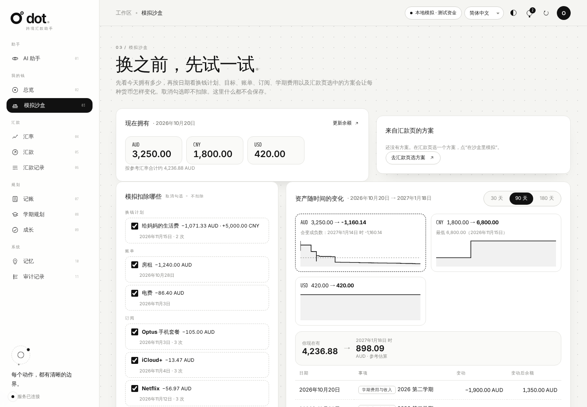
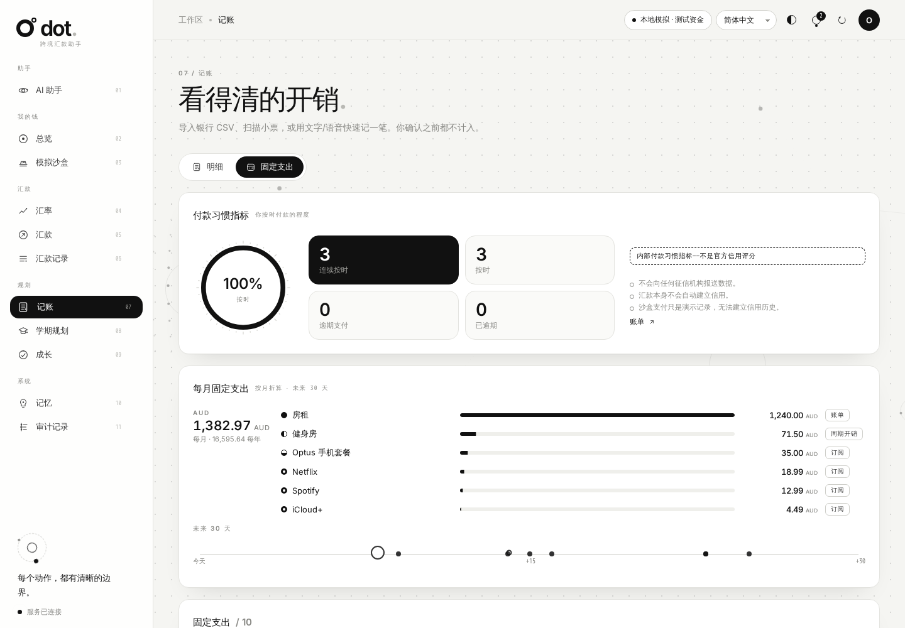
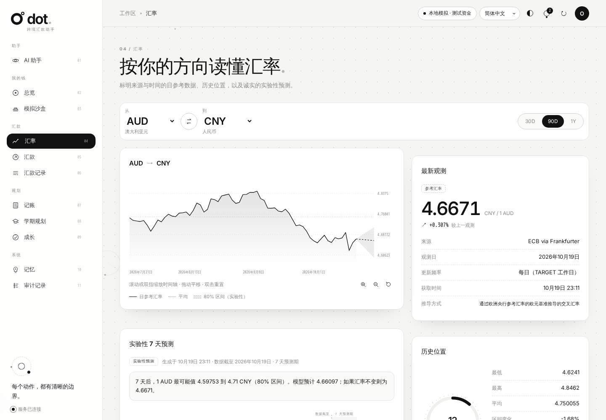
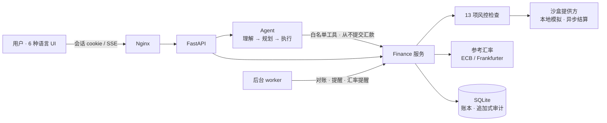

<div align="center">

[English](README.md) · **简体中文**

# ◉ DOT · AI 跨境汇款助手

**一个会「理解 · 规划 · 安全执行」的金融 Agent —— 比较方案、预测汇率、提醒你何时换汇，并把日常开销理清楚。**

    


</div>

---

## 这是什么

跨境汇款时，人们要同时考虑汇率、手续费、可用资金、收款人和到账时间。**参考汇率算出的金额 ≠ 扣费后真正到账的金额**，最低手续费也不一定到账最多。

DOT 是一个自然语言 AI Agent，帮你：

- 💬 **用对话完成一切**：账单、订阅、余额、学期、奖学金、邮件摘要、路线、限额……都可以直接跟助手说；它生成确认卡片，你点“确认执行”才生效。付款始终由你亲手完成
- 🔍 **看懂汇率**：真实的 ECB 日参考汇率，带来源与时间；按你的汇款方向解读历史高低位
- ⚖️ **比较方案**：参考计算、模拟方案、沙盒报价三者严格区分，按到账金额或速度排序
- 📝 **准备支付**：固定发送额，或按“对方要收到多少”反算
- 🛡️ **安全执行**：13 项风控检查 + 你的明确授权；AI 助手只查询、解释和准备，汇款永远只由你本人提交
- 💱 **规划换汇**：看清每种货币有多少，规划换多少，在沙盒里模拟换完还剩多少，并按币种提醒缺口
- ⏰ **挑好时机换汇**：比较之后设置提醒——目标汇率、“有利水平”（近 90 天最好的 10–30%）或最晚换汇日；可选浏览器通知
- 🧾 **理清日常开销**：导入银行 CSV、扫描小票、文字或语音快速记账（“午饭 35元”）；自动建议分类、标记疑似重复、周期开销、一键批量审核
- 🏛️ **比较银行而不只是汇率**：AI 读取各银行官网公开的汇率与收费页（读不到时用已有知识补全并标明为估计），生成换汇方案：在哪家银行换、一次付清还是分两次付
- 🎓 **学期规划**：“我买得起吗？”判断、按学期的现金流规划（学费、生活费、收入）、奖学金与助学金跟踪（截止日期与材料清单）、带具体建议的周/月消费洞察，以及可选每日/每周/每月的邮件摘要和紧急提醒
- 🏦 **银行转账模板**：SWIFT 电汇及本地格式（SEPA、BSB、FPS、ACH、CNAPS、NEFT），输入即校验，生成可复制的转账指令和 MT103 预览
- 🌱 **温和地保持动力**：里程碑徽章、宽容的连续打卡、可选的短期挑战、理财技能等级和庆祝时刻；不排名、不施压、不分享
- 🧾 **全程可追溯**：谁授权了什么、跑了哪些检查、之后发生了什么，一条审计轨迹全部回答

> 本项目实现了课程/产品文档《AI Cross-Border Remittance Assistant》v4.0 中的全部功能模块（4.1–4.15），对照表见[下文](#-文档需求对照)。

---

## ✨ 亮点

### 1. 问一句，得到能用的卡片

Agent 每轮对话先调用 `record_plan` 记录**意图、提取的金额币种收款人、缺失信息、计划步骤**，再调用工具。结果以果冻卡片落在**结果面板**上，可以拖拽、合并（问 DOT 两个结果有什么关系）和点开；需要只有你知道的信息时——收款人、模板的银行信息、换钱计划、你的余额——会在聊天旁弹出预填好的表单。AI 助手能查询、解释，准备草稿、计划和模板，但没有任何提交或批准汇款的工具。


- 未配置大模型时，由**离线规则规划器**驱动同一条流水线（明确标注“不是 AI”），支持 6 种语言的常见意图，缺信息会追问并在下一句补全
- 配置任意 **OpenAI 兼容**、支持 function calling 的模型后即为真 AI
- 模型工具里**没有**“批准”“提高额度”——说“好的”永远不等于授权

### 2. 先比较，再汇款


输入金额实时比较：参考汇率基准、三种模拟方案（银行电汇 / 在线汇款 / 即时取现）与可执行的沙盒报价，列出固定费、百分比费、适用汇率、价差、时效、较参考损失和**未包含的费用**。

### 3. 授权必须是一个刻意的动作


授权屏显示环境标签、精确金额、费率来源、报价倒计时、状态时间线和逐项风控检查。勾选确认后需要**长按圆环**才能授权；授权绑定详情摘要（SHA-256），任何改动都会使其失效。

### 4. 资金一目了然——换钱计划、模拟沙盒与缺口提醒

**总览**按一条思路展开：*我有多少钱 → 我打算怎么换 → 换完还剩多少 → 哪里还差钱？*



- **我有多少钱**——每种货币的最新余额（手动填写或从银行 CSV 读出），**各自用自己的币种**大字显示，不再用一个折算后的总数当标题，避免把澳元和人民币搞混；**资产币种结构条**显示每种货币的占比，另有一行小字给出按参考汇率折算的合计（估算）。
- **换钱计划**——你的打算：“25 号前用人民币换到 4,300 澳元交学费”，或“花 20,000 人民币”。计划可以按“要收到多少”或“要花多少”来定；点开计划即可修改，并实时预览汇率、要付多少、各币种换完还剩多少、能覆盖多少需求。系统会根据尚未覆盖的学费、学期生活费和账单自动生成建议计划。计划只是打算，不会真的换汇；AI 盯盘会按每个计划的金额、日期和最低可接受汇率（硬性限制）判断时机。汇款页的“需求”表单和 AI 助手（`plan_exchange` 或弹出的计划表单）创建的都是同一种计划。
- **模拟沙盒**（左侧栏单独成页，总览只放一张摘要卡）——把换钱计划按数字套用到你的余额上，逐币种显示换前/换后；可以试试汇率变差或变好（−3%、−5%、+3%）、加一笔假设资金（“如果爸妈再打来 20,000 人民币”），或去掉某个计划，这些都不会保存。下方的**模拟支付**列表显示 DOT 或你准备的支付对测试余额的虚拟影响：*未完成* 时只预留，模拟完成后才扣除。全程不涉及真实资金。
- **缺口提醒**——按币种计算未来 60 天：持有 + 计划换入 − 计划换出，对比需要的钱（学费、生活费、账单、只为某个用途的计划）加安全垫。图中显示已有、计划换入和斜线标出的缺口以及“需要线”；文字给出不换的话差多少、按计划换完差多少、汇率差 3% 时差多少。“补一个计划”会打开预填好的计划。没录入余额的币种会单独提示，而不是瞎猜。
- **预警**——7 天内到期的缺口、计划换出超过持有、汇率低于你的底线、计划即将到期都会生成提醒；开启邮件后紧急的立即发送，其余进入摘要。

### 5. AI 替你盯汇率

「汇款」页第 ③ 步首先是 **AI 盯盘**。对你用到的每个币种对（进行中的目标和最近的汇款会自动加入），AI 会自行判断现在是否适合换汇：它综合 90 天位置、与 90 天均值的差距、近期走势、实验性 7 天预测（以及预测是否在回测中优于基线），还有你的截止日期。结论分为“好时机 / 可以再等等 / 截止临近，尽快换 / 低于你可接受的汇率 / 暂无明显信号”，附带把握程度和理由标签；配置了模型时，还会有模型用你的语言写的一段简短解释。后台每十分钟复查一次，判断变为“好时机”或“截止临近”时提醒你（铃铛、浏览器通知，开启的话还有邮件）。

**你可以辅助它。** 你的**换钱计划**（在总览、本页的“需求”表单里创建，或直接告诉 AI 助手）给出需要收到的金额、最晚日期和最低可接受汇率。这些是硬性限制：低于你的底线时绝不会说“好时机”，截止临近时绝不会建议再等。没有配置模型时，由一套透明的规则引擎做同样的判断。目标汇率、有利水平、最晚换汇日等固定规则仍然保留，作为可选补充。系统永远不会自动替你换汇。

### 6. 银行转账模板（SWIFT 与本地转账）

「汇款」页的「银行转账模板」标签保存你常付的银行信息，支持七种格式：**SWIFT** 国际电汇、**SEPA**（IBAN）、**澳洲 BSB**、**英国 Faster Payments**（sort code）、**美国 ACH**（ABA 路由号）、**中国 CNAPS** 和 **印度 NEFT/IMPS**（IFSC）。每个字段输入时即时校验——BIC 结构、IBAN 校验位与各国长度、ABA 校验位、BSB / sort code / IFSC / 联行号格式、SWIFT 字符集（中文名必须用账户上的拼音拼写）、BIC 与 IBAN 国家不一致，以及人民币电汇通常需要填写用途代码的提示。

已核实的模板可打开**可直接复制的转账指令**（逐项复制、全部复制、下载 .txt），SWIFT 模板还附 **MT103 字段预览**（:32A:、:57A:、:59:、:70:、:71A:）供参考——真正的报文由你的银行生成，DOT 从不发送任何指令。账号在所有地方都打码，只有所有者打开的指令单显示完整号码。由助手起草的模板、以及银行信息被修改过的模板，在你对照官方来源核实前都保持**未核实**状态——每张指令单都会提醒“银行信息已变更”类诈骗。“比较与规划”会带着模板的币种、金额和用途切换到“比较并汇款”标签；选中一位有已核实模板的收款人时，汇款表单会给出模板链接，生成草稿后也会提醒你去银行转账时用哪份模板。AI 助手还能根据你在聊天里贴的银行信息填好模板：表单自动弹出并预填，有问题的字段用 ⚠ 标出并写明原因；关掉表单后草稿会留在结果面板上，随时可以继续填写。

### 7. 看得清的开销



「记账」页为留学生设计：把银行导出的 CSV 拖进来（自动识别逗号/分号、支出/收入分列、日在前的日期和 GBK 编码），每一行都以**待审核**状态进入，附带建议分类和疑似重复标记（同商家同金额 ±2 天内，含重复导入的账单）。勾选、批量改分类、确认——你的修改会按商家学习。**图片：**可以拖入、粘贴或选择最多 4 张图片——购物小票，或银行/卡片 App 的交易列表截图；视觉模型会读出其中每一笔交易（把“昨天”“星期日”换算成日期，正确处理 `A$12,10` 这种逗号小数，跳过没有金额的行），你在列表里核对后再保存。**快速记账**用你习惯的写法就行：`lunch 12.50`、`午饭40澳刀`、`2026年10月19号 午饭10澳元`、`午饭10澳元 打车25`（两笔）、`上周五 coles 21.50`、`ランチ 1200円`，也支持语音。离线快速规则能瞬间读懂大多数写法；读不懂时，点“AI 识别”（或直接回车）交给大模型。AI 助手的 `log_expense` 也用同一套识别。周期开销（房租、话费、订阅）会提前一周生成**预计**条目等你确认或调整。AI 助手也能记账（`log_expense`），但同样进入审核队列。

### 8. 学期规划

「学期规划」页用你自己的数字规划整个学期：

- **我买得起吗？**——输入价格，对照现有现金（账本 + 你填写的持有资金）、学期计划、即将到期的学费和其他支出、安全垫，以及本月预算剩余，给出“可以买 / 可以但偏紧 / 现在不建议”，附带数字、买前买后余额曲线和更稳妥的日期。
- **学期现金流**——添加学期（起止日期、学费及截止日、每月生活费和收入）。每月金额按天平摊，学费按日期计入，已获得的奖学金按发放日计为收入，学期以外的月份按你已确认开销的平均值估算。结果包括期初现金、每月月末余额、最低点和首次缺口。
- **奖学金与助学金**——从“了解中”到“已获得”的状态、截止倒计时、材料清单（成绩单、简历、个人陈述、推荐信……），材料未齐时在截止前 14/7/3/1 天提醒；学费截止日同样提醒。
- **消费洞察**（在「记账」页）——最近 7 天或 30 天与上一期及平时水平对比，给出建议：哪类开销上升、频繁的小额消费、订阅总额、学期预算进度、即将到期的学费和计划缺口，并估算能省多少。
- **邮件报告**——可选**每日、每周（自选星期几）或每月**摘要：各币种余额、货币缺口（含汇率差 3% 的情况）、换钱计划、AI 对换汇时机的判断、消费与提醒。**紧急情况立即提醒**（7 天内到期的缺口、汇率低于你的底线、计划换出超过持有、支付异常）可以不等摘要直接发送；没有变化时会跳过摘要。通过你自己的 SMTP 服务器只发给你保存的那一个地址；没配置 SMTP 也能预览。

这里的一切都是基于你的计划和已确认开销的估算，不构成理财建议，也不会动用任何资金。

### 9. 成长：以鼓励为主

「成长」页加入轻量的游戏化机制，帮助培养理财技能，但不制造竞争：

- **徽章**：记录、规划、习惯、目标四类共 16 个里程碑——第一笔记账、记账一周、学期计划、安全垫、提交申请、材料齐全、达成目标……
- **宽容的连续打卡**：记账或审核开销、更新计划/目标/奖学金都算打卡；连续休息不超过两天不会中断。中断后显示“欢迎回来”而不是惩罚；用圆点展示最近 8 周。
- **短期挑战**（7 天、可选、最多同时 3 个）：5 天记账、清空待审核、规划学期、再完成一份材料、检查订阅、一天不乱花、存一点点。可测量的挑战自动完成，其余由你自己标记。停止或到期显示“已结束——没关系”，从不算失败。“存一点点”建议金额不超过 10 个货币单位或一周预算的 5%，超出承受范围的金额会被拒绝。
- **等级 1–5** 描述的是技能，每级都有清晰的达成条件清单——从不涉及余额或排名。
- **庆祝时刻**：获得徽章、升级、完成挑战、打卡里程碑、达成目标或获得奖学金时，弹出圆点绽放动画。功能上线前的历史会被安静地记录，不会一次弹出一堆。

一切都来自你自己的操作，不比较、不分享，成长功能和庆祝动画都可以关闭。

### 10. 工具与记忆

**工具**在 [`finance/tools.py`](finance/tools.py)。每个工具用 `@tool(名称, 说明, 参数, 类型)` 在实现旁边声明一次（类型：查看或准备）；Agent 统一做参数校验并逐次写审计。共 41 个工具，包括 `request_details`（弹出表单）、`plan_exchange`、`simulate_exchange`、`money_overview`、`check_bank_details`、`draft_transfer_template`、`exchange_advice`、`progress_overview`、`start_challenge`、 `afford_check`、`cashflow_plan`、`spending_insights`、`track_scholarship`、`log_expense`、`remember_note`——并且刻意没有“提交或批准支付”“提高额度”“修改收款人”。新增工具只需写一个带装饰器的函数。

**记忆**在 [`finance/memory.py`](finance/memory.py)，分三层：

| 层 | 内容 | 用法 |
| --- | --- | --- |
| 对话 | 每个会话最近 12 轮 | 每次请求一并发送，便于理解追问 |
| 笔记 | 你让它长期记住的事实：人物、习惯、偏好 | 每轮把最相关的笔记作为**数据**注入；Agent 用 `remember_note` 保存，你可以在「记忆」页查看和删除 |
| 经历 | 每轮一条：请求、意图、调用（及被阻止）的工具、涉及的支付、结果 | 可用 `recall_memory` 检索；最近经历让 Agent 保持连续性 |

检索支持多语言（拉丁文字按词、中日韩按字符二元组）。记忆拒绝保存密码、密钥和完整账号/卡号，从不授予权限，也从不作为余额或支付的证据。


### 11. 黑白点线圆 · 会动的极简

| 汇率 · 历史位置与 7 天预测 | 深色模式 |
| --- | --- |
|  |  |

- 点阵背景随鼠标形成**放大镜**，点线圆星群缓慢漂移、随滚动视差
- 页面切换的**景深过渡**：前进时旧页推远模糊、新页拉近；手机**左右滑动**切页
- 汇率图支持**滚轮/双指缩放、拖拽平移**；助手结果面板上的卡片是柔软的“果冻”方块，可拖动、合并、点开
- 弹窗从打开它的卡片里展开；液态指示块跟随标签；滚动揭示、数字滚动、绘线动画
- 登录成功后，登录页的圆点飞到左上角，瞳孔张开成 dot 标志的圆环（手机上变成头像），应用在它下面淡入
- 尊重 `prefers-reduced-motion`；零外部依赖，严格 CSP（仅 `'self'`）

### 功能都在哪里

左侧栏按你要做的事来分：**助手**（AI 助手）· **我的钱**（总览、模拟沙盒及测试资金）· **汇款**（汇率——含各银行汇率与电汇费用表；汇款——含“比较并汇款”
“收款人”（含支付限额）“银行转账模板”三个标签；汇款记录——只显示你自己的汇款和准备要汇的款，不含自动化测试产生的记录）·
**规划**（记账——分“明细｜固定支出”两个标签，固定支出把账单、周期开销和订阅合成一张表并配图表，最上方是付款习惯指标；学期规划——学期现金流、额外收入/支出/安全垫、奖学金；成长）· **系统**（记忆、审计记录）。路线管理
在汇款页的“更多路线”里打开。邮件设置在右上角的「设置」里。

**目标并入换钱计划。**原来的“目标”现在就是换钱计划：计划可以指定收款人和用途类别，关联的汇款会计入进度（已汇 / 在途 / 剩余），只有剩余金额参与换汇模拟。已有的目标在升级时自动转换成计划，原记录归档不删。

**账户与登录。**用邮箱和密码注册、登录（密码只存加盐 scrypt 哈希，连续输错 5 次锁定 5 分钟）。每个账户有独立的数据库，
互相看不到；本机原有数据只有提供 `OWNER_TOKEN` 才能认领（“认领本机已有数据”）。“先看看演示”进入用完即删的演示空间，
不会打开任何人的真实数据。登录页右上角可以直接选择语言。登录页是一个会跟随光标、
可以拖拽回弹、输入时点头、输密码时闭眼、出错时摇头（并震动）的果冻圆点，一次只问一个问题。

**一本账。**总览里的余额就是汇款页的“可用”：模拟付款完成后自动从余额里扣除并记一笔“汇款后自动更新”；没填过余额的币种才使用测试资金，并明确标注。
记账里可以添加**借记卡、信用卡、现金账户**，导入账单时选择账户。信用卡还款和本人账户互转会在两边自动配对（金额相同、±5 天），
连没写“还款”的也能从另一边认出来，所以刷卡 100 再还款 100 只算一次消费；退款冲减对应类别；统计分开显示“消费”“现金流出”和“信用卡待还”；
信用卡余额永远不算作你的钱，币种余额 = 所有借记卡和现金账户之和。

**帮你决定什么时候换。**汇率页的焦点是“现在换合适吗？”：今天在过去 90 天里的位置（有足够天数时按你银行自己的牌价）、
按你要换的金额算出“再等 7 天有百分之几的可能更好，最可能多/少多少钱，80% 区间”，预测跑不赢“汇率不变”时直接说明。
**条件换汇**：设一次“1 CNY ≥ 0.2150 AUD 时最多换 6 万、11 月 10 日前”，达到时提醒你一键确认，或自动换（模拟，更新你的余额）；
不超过上限和余额、不重复、过期不换，快到期仍未达到只提醒。换完后给出“比 30 天均价多换到多少”，可以复制发给爸妈。
汇款方案里把**汇率价差折成钱**，和手续费分开列出。记账有**月度预算**（85% 和超支时提醒），一周没记账会提醒截一张账单图。

**每页有重点，卡片自己排。**每个组件都是独立卡片；每页的焦点卡突出显示；只会显示“暂无内容”的次要卡片自动隐去；
次要细节默认折叠成一行。按住卡片标题或顶部的抓手拖动（跟随速度轻微倾斜拉伸、其他卡片顺滑让位、靠近空位被吸入、Esc 取消），
拖到另一张卡旁边可以并排，拖右下角改宽度；卡片按瀑布流排布，任意两张卡之间的距离都相同，不留大空隙；
双击或点箭头折叠，Alt+↑/↓ 用键盘调整，顺序和折叠按页面记住。**DOT 在每一页**：右下角的小圆点可拖到任意位置、松手吸附到边，
点开（或 Ctrl+K）就是同一段对话，知道你在哪一页，并给出贴合本页的建议。

**用对话完成一切。**除了付款本身，App 里的操作都可以直接对 AI 助手说：加账单或订阅、改余额、记一笔或改分类、建学期、跟踪奖学金、改邮件摘要、开关路线、设限额……助手先查你的记录（read_records），再生成一张**确认卡片**（do_action），列出要执行的操作和参数；只有你点“确认执行”才会生效，而且执行时服务端会再校验一次。付款的授权和提交仍然只能在汇款页由你亲手完成。

**银行与换汇方案。**在汇款页选好两种货币，并可选择汇出银行和收款银行。数据来源按顺序：① AI 读取银行官网公开页面
（汇率表、收费标准），**每个数字都必须附上页面原文**，原文不在页面上或不含该数字就丢弃；页面内容一律当作不可信数据；
② 官网没写的部分，用 Wise 公开的第三方比价数据（每天从各家采集，标明采集时间）补充；③ 再不行才用 AI 已有知识估算；
④ 最后才手动填写。打开汇率页或在汇款页选好币种后，**自动读取**这个币种对涉及的全部银行（24 小时内读过的跳过），后台还会每 6 小时为换钱计划里的币种对更新一次。澳洲中行（Bank of China Australia）同时出现在汇出和收款两侧。随后生成**换汇模拟方案**：在汇出行换汇，
或汇原币由收款行换汇；一次付清，或分两次付。费用**按原币种分别列出**，合计时按参考汇率换算并注明汇率；方案按数据完整度分区——
只有每个数字都有来源、且能在截止日前到账的方案才排名，只有它们能被标为“最划算”；缺费用的是“暂估”，AI 估算的放在“情景参考”。
填了到账日期时，按通道到账天数（如电汇 1–3 个工作日）算出**最晚发起日**；第二笔严格放在预测对应的日期，来不及就标为“来不及到账”。方案可以加入换钱计划，也可以放进**模拟沙盒**：先显示今天拥有多少，
再按日期显示换钱计划、目标、账单、订阅、学期费用和这个方案会让每种货币怎样变化，每一项都可以选择不扣除。

### 12. 六种语言

English · 简体中文 · 繁體中文 · Tiếng Việt · 日本語 · 한국어 —— 数字、日期、地区名均用 `Intl` 本地化，后端错误码由前端翻译。

| 한국어 | Tiếng Việt |
| --- | --- |
|  |  |

---

## 🏗 架构



| 模块 | 文件 |
| --- | --- |
| Agent 编排（模型循环、流式事件、经历记录） | `finance/agent.py` |
| **工具注册表**——每个工具的参数、类型与实现 | `finance/tools.py` |
| **记忆**——对话、笔记、经历、检索 | `finance/memory.py` |
| 离线规则规划器 | `finance/agent_rules.py` |
| 支付核心、风控、授权、路线 | `finance/service.py` |
| 比较、情景、目标预算、建议与提案 | `finance/planning.py` |
| 付款习惯、提醒去重、汇率提醒 | `finance/habits.py` |
| AI 盯盘：信号计算、模型判断（规则兜底）、你的需求作为硬性限制 | `finance/watch.py` |
| 转账模板：SWIFT/SEPA/BSB/FPS/ACH/CNAPS/NEFT 格式、校验、转账指令、MT103 预览 | `finance/templates.py` |
| 参考汇率、历史分析、回测预测 | `finance/rates.py` |
| 沙盒提供方 | `finance/providers.py` |
| 记账：CSV 导入、分类、去重、审核、周期、快速记账 | `finance/expenses.py` |
| 学生理财：奖学金、学期、现金流、买得起判断、洞察、邮件报告 | `finance/student.py`、`finance/student_i18n.py`、`finance/mailer.py` |
| 成长：徽章、宽容打卡、挑战、等级、庆祝 | `finance/motivation.py` |
| 现金与换汇需求 | `finance/money.py` |
| 银行汇率与费用（官网 → 第三方 → 估算）、换汇方案 | `finance/banks.py` |
| 何时换：等待的价值、条件换汇规则、月度预算、银行汇率历史 | `finance/decide.py` |
| 换钱计划 | `finance/plans.py` |
| 账户、登录、注册限流、所有者令牌认领 | `finance/auth.py` |
| 发给模型前的脱敏、数据导出 | `finance/privacy.py` |
| 对话里需确认卡片才执行的操作 | `finance/actions.py` |
| API、SSE、独立服务 | `finance/api.py`, `finance/web.py`, `finance/worker.py` |
| 前端外壳、各页面、登录、卡片、DOT 小圆点（原生 ES modules） | `frontend/dist/js/app.js`, `views/*`, `auth.js`, `cards.js`, `assistant.js` |

---

## 👥 组员：从 GitHub 下载后如何运行

**需要：** 本私有仓库的访问权限（请仓库所有者把你加为 Collaborator）、[Git](https://git-scm.com/)、[Python 3.10+](https://www.python.org/downloads/)、[Docker Desktop](https://www.docker.com/products/docker-desktop/)（保持运行）。

```bash
git clone https://github.com/ytan0008/dot-remittance-agent.git
cd dot-remittance-agent
python scripts/configure.py          # 生成你自己的 .env（令牌和密码），不会显示任何密钥
docker compose up --build -d --wait  # 第一次构建需要几分钟
```

打开 **http://localhost:8787** —— 会自动以本机 Owner 身份进入。

- **接入 AI 模型（可选）：** 在 `.env` 中填写*你自己的* Key：`OPENAI_API_KEY=sk-...`（已预设 `gpt-6-luna`），保存后执行 `docker compose up -d --force-recreate backend`。不填 Key 时 Agent 以标注清楚的离线规则模式运行。不要提交 `.env`，也不要在聊天里分享 Key。
- **数据互不影响：** 每个人的副本都有独立的数据库和测试资金。
- **端口被占用？** 在 `.env` 加一行 `FRONTEND_PORT=8799`，改用这个端口打开。
- **更新到最新代码：** `git pull`，然后 `docker compose up --build -d --wait`。
- **停止 / 启动：** `docker compose stop` / `docker compose up -d`。清空本地全部数据：`docker compose down -v`。
- **不用 Docker 跑测试：** `python -m venv .venv`，再 `.venv\Scripts\pip install -r requirements.lock.txt`（macOS/Linux 用 `.venv/bin/pip`），然后 `python -m pytest -q`。

## 🚀 快速开始

### Docker（推荐）

```powershell
python -m venv .venv
.\.venv\Scripts\python -m pip install -r requirements.lock.txt
.\.venv\Scripts\python scripts/configure.py      # 生成 .env：令牌和密码（不输出密钥）
docker compose up --build -d --wait
```

打开 **http://localhost:8787**。本机演示模式会自动以 Owner 身份登录。

### 不用 Docker

```powershell
$env:ENABLE_DEMO_LOGIN = 'true'
.\.venv\Scripts\python -m finance.cli serve       # UI: http://127.0.0.1:8000  · API 文档: /api/docs
```

### 接入大模型（可选）

在 `.env` 设置 `OPENAI_API_KEY`、`OPENAI_MODEL`，可选 `OPENAI_BASE_URL`（任意 OpenAI 兼容服务），然后 `docker compose up -d --force-recreate backend`。

### 邮件报告（可选）

在 `.env` 中填写 SMTP（`SMTP_HOST`、`SMTP_PORT`、`SMTP_SECURITY`、`SMTP_USER`、`SMTP_PASSWORD`、`SMTP_FROM`），然后运行 `docker compose up -d --force-recreate backend`，再到右上角「设置 → 邮件报告」保存你的邮箱（或者直接对助手说“每周摘要发到 me@example.com”）。Gmail / Outlook 请使用应用专用密码。

### 试试新功能

1. 「总览」→ 填入各币种余额 → 采纳一条建议的换钱计划（或“新计划”）→ 看模拟沙盒和缺口提醒随之变化；试试汇率 −3% 或加一笔假设资金
2. 「汇款」→ 输入金额 → 第 ③ 步查看 AI 盯盘的判断；把金额、最晚日期和最低可接受汇率保存为换钱计划，或展开“添加自定义规则”
3. 「记账」→ 拖入银行 CSV → 审核待确认的行（疑似重复默认不勾选）→ **确认**
4. 「学期规划」→ 添加学期 → 输入价格问“我买得起吗？”；跟踪一个奖学金并勾选材料；在「设置」里选每日/每周/每月邮件摘要
5. 「记账」→ 输入 `午饭 35元`（或点麦克风）→ **保存**；或 **扫描小票**（需要支持图像的模型，否则手动填写）

### 沙盒测试金额

| 金额小数 | 结果 |
| --- | --- |
| 普通金额 | 提交 → 处理中 → 约 8 秒后完成，结算一次 |
| `.13` 结尾 | 服务商拒绝 → 失败，释放预留资金 |
| `.57` 结尾 | 响应丢失 → “结果待核对”，按自身 ID 查回原交易，**绝不新建第二笔** |

---

## 📋 文档需求对照

| 模块 | 实现要点 |
| --- | --- |
| 4.1 资金与转账需求 | 固定发送额或目标到账额（反算保证不少于目标）、用途、到账日期、关联目标；缺失信息先追问 |
| 4.2 地区与 APEC 路线 | 21 个 APEC 经济体（币种/语言/时区）；路线增删启停；支付需单独开启且服务商支持；参考数据验证能力 |
| 4.3 最新汇率 | ECB 优先，缺失时用 Frankfurter 混合源并标注；来源、方向、观测日、频率、变化、交叉推导；**不编造** |
| 4.4 历史分析 | 30/90/365 天最低最高平均、百分位、高中低位、新高新低、覆盖率；按方向解读 |
| 4.5 预测与情景 | 实验性 7 天模型 + 滚动回测，与“不变汇率”基线对比、留出数据检验区间覆盖；情景计算器 |
| 4.6 方案比较 | 参考计算 / 模拟方案 / 沙盒报价三类区分；按到账或速度排序并说明依据；未计费用披露 |
| 4.7 多币种资金 | 分币种总额/可用/预留；参考等值注明来源且“并非兑换”；确认后才结算，失败才释放 |
| 4.8 目标与预算 | 已完成与已计划分离；收入/支出/安全缓冲/自填持有；一次性 vs 分期与资金缺口 |
| 4.9 自然语言 Agent | 首步强制记录计划；SSE 流式三阶段；数据类型标注；聊天与界面共享状态 |
| 4.10 权限与风控 | AI 助手只查询和准备，只有本人能批准和提交；13 项检查在授权前与提交前各跑一次，逐项入审计 |
| 4.11 端到端沙盒转账 | 报价 → 风控 → 授权屏 → 长按授权 → 幂等提交 → 异步跟踪 → 结算 → 回执；失败与超时恢复 |
| 4.12 授权与历史 | 接受建议 / 确认修改 / 授权支付 三类独立记录；修改即作废旧授权 |
| 4.13 审计 | 时间、执行者、动作、结果、关联 ID、请求 ID；拒绝也记录；敏感信息打码；触发器禁止改删 |
| 4.14 信用习惯 | 应付项目与每月重复、按时/逾期、内部指标（显著标注“不是信用评分”）、信用知识 |
| 4.15 提醒与回执 | 截止、报价过期、未决交易、资金不足、目标汇率、有利水平、换汇日、预计开销、奖学金与学费截止；指纹去重；浏览器通知与邮件；可打印回执 |
| 扩展：记账 | 银行 CSV 导入（建议分类、重复检测、审核步骤）、小票扫描、文字/语音快速记账、周期开销、批量审核 |
| 扩展：成长 | 徽章、宽容的连续打卡、可选挑战、理财技能等级与庆祝时刻——鼓励、私密、不竞争 |
| 扩展：学生理财 | “我买得起吗？”、学期现金流规划、奖学金与助学金跟踪、带建议的周/月洞察、邮件报告与提醒 |

---

## 🔐 安全模型

- **角色分离**：Owner / Agent / Viewer 令牌由后端区分；浏览器使用 HttpOnly + SameSite=Strict 会话，写请求要求同源头
- **授权绑定**：沙盒支付需 Owner 对报价摘要逐笔授权；字段、收款人变化或报价过期即失效
- **未确认不计入**：导入、扫描和 AI 记下的开销都保持待审核，直到你确认；小票照片在浏览器里先压缩，且不会被保存
- **精确金额**：后端一律最小单位整数，超过 2^53 以字符串传输，前端 BigInt 格式化
- **模型约束**：工具白名单、参数校验、轮数上限；疑似私钥/API key 的消息直接拒绝
- **发给模型前脱敏**：账号、卡号、IBAN、邮箱先换成占位符（如 `[ACCT_1 …2222]`），工具参数里才在本机换回真实值；图片无法遮盖，界面会提示
- **外部内容是数据**：银行网页、小票、账单文字都按不可信数据处理；银行数字必须附页面原文、且与参考汇率相差不超过 15%，否则丢弃
- **你的数据**：设置 → 隐私与数据：导出全部数据（JSON）、永久删除对话或记忆笔记、注销账户（新账户）
- **退出与会话过期**：退出登录、会话过期或在别处退出时，都会回到登录界面
- **账户隔离**：每个账户一份数据库；演示入口是单独空间；`PUBLIC_DEPLOY=true` 时如配置了链上或真实支付会拒绝启动（见 `.env.competition.example`）
- **原有数据**：实例上原有的数据不属于任何人，只有提供 `OWNER_TOKEN` 才能认领（注册时或在设置里）；每个演示会话都有自己的临时空间，24 小时后删除
- **账务一致**：账单余额只有是“最新信息”时才会成为你的余额——未来日期、重复导入、早于换汇记录的余额都不会覆盖，并提示你手动对账；条件换汇原子执行（不会执行两次、不会过期执行、不会超过余额）
- **严格输入**：真实日历日期、有范围的整数金额、强类型的审核项；注册限流在同一个事务里计数和占位；手续费数字必须和币种写在一起，且所在句子不含其他币种、不是最低额或限额
- **经过攻击测试**：两轮对抗测试（157 项：访问控制、CSRF、SSRF、并发、账务、证据）已纳入正式测试
- **验收与测试材料**：[真实模型学费规划验收记录](docs/acceptance/tuition-scenario.md) · [可用性测试材料](docs/usability-test.md)

---

## 🧪 测试

```powershell
.\.venv\Scripts\python -m pytest -q        # 386 项（含两轮安全审计用例）：服务、风控、记账、AI 盯盘、转账模板、学生理财、成长、邮件、提醒、API、规则规划器、6 种语言
.\.venv\Scripts\python -m finance.demo     # 离线演示：未授权被拒 → 授权 → 执行 → 幂等 → 超时恢复

docker build -f tests/browser/Dockerfile -t remittance-agent-browser-test .
docker run --rm --network remittance-agent_default --mount "type=bind,source=$PWD/artifacts,target=/artifacts" remittance-agent-browser-test
```

浏览器验收：完整支付流程 + 13 个页面 × 6 种语言 × 桌面/手机全量巡检（无 JS 错误、无漏翻、无横向溢出）。

---

## ⚠️ 已知边界

- 文档要求的“服务商沙盒”需真实服务商凭据，当前以**带标注的本地模拟**代替；接入时实现 `quote / submit / find / status` 即可
- 链上支付已暂停：界面和 Agent 提供方案、预测和提醒，不做加密货币转账。直连银行取决于各地监管，因此记账从 CSV 导出开始。
- 预测为实验性功能；付款习惯指标不是信用评分，沙盒记录不构成信用历史
- 单用户开发原型。正式上线还需 HSM/KMS 签名、身份与 MFA、多租户、限流、备份与合规审查

<div align="center"><sub>◉ DOT — every action has a clear boundary.</sub></div>
