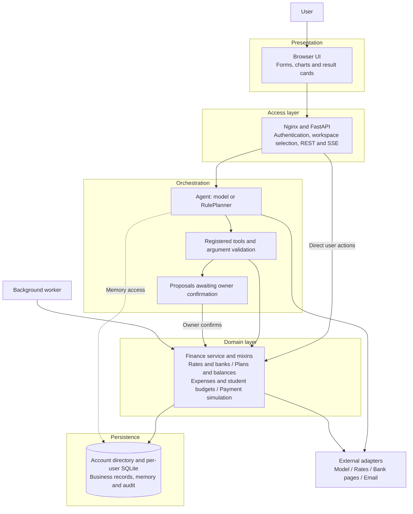
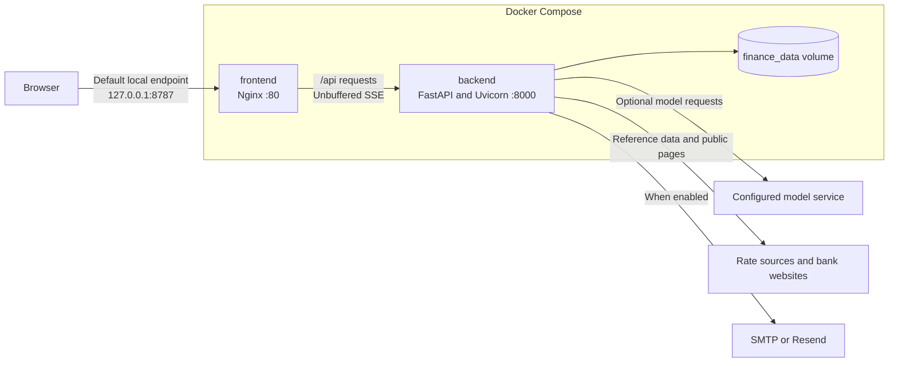
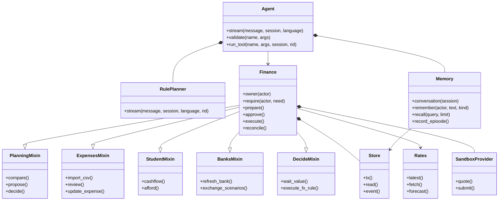
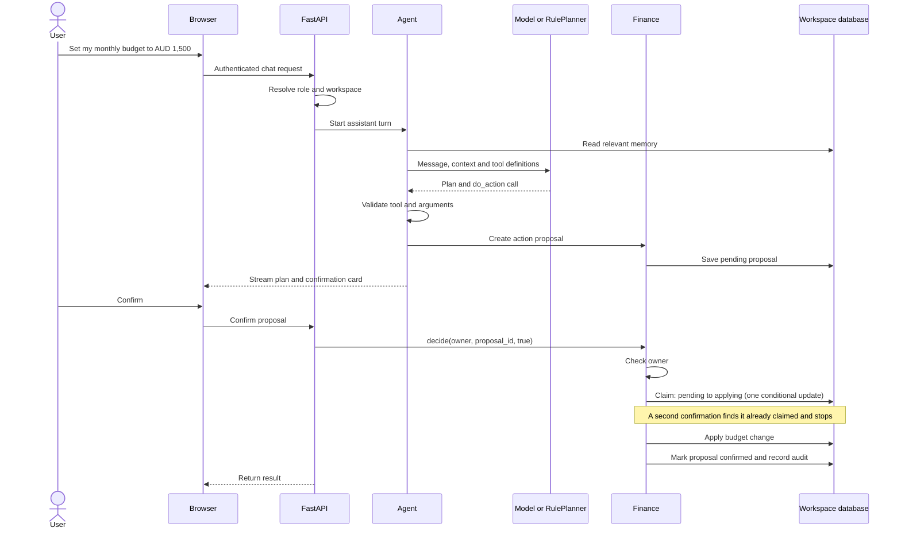
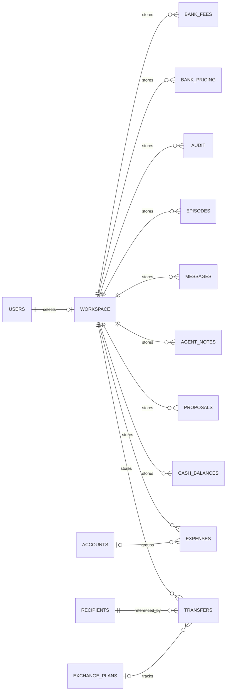
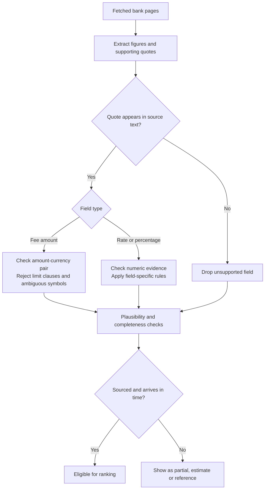
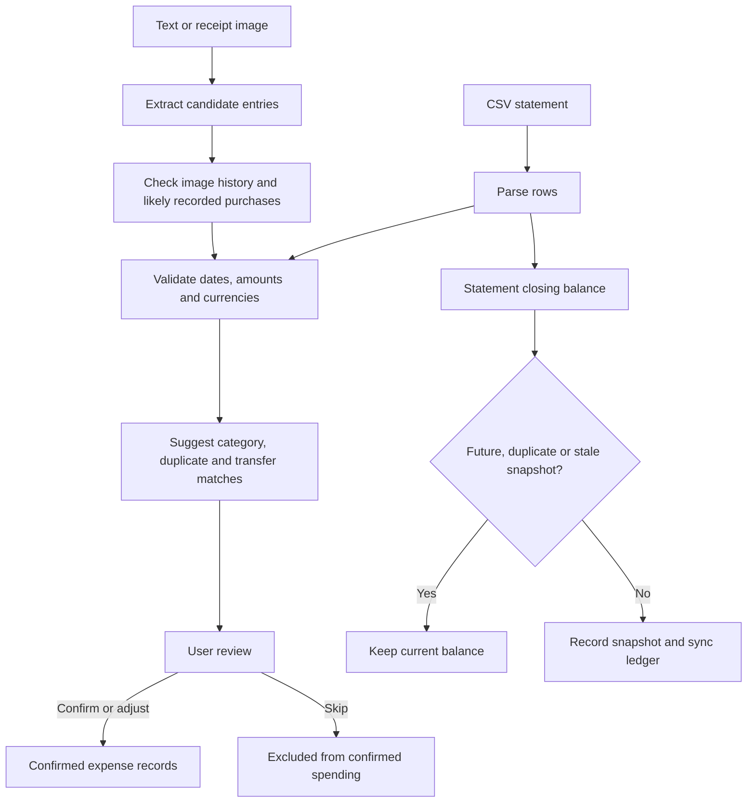
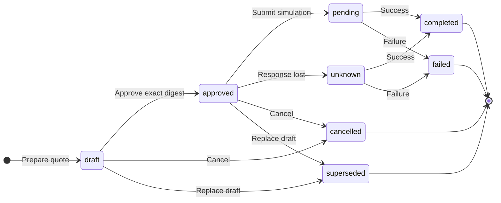
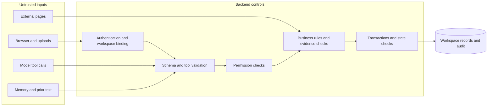

# DOT: Technical Documentation and Security Self-Assessment

**Team:** Dotopia
**Track:** Topic C — Cross-border & Student Finance Assistant
**Competition mode:** Non-on-chain
**Reviewed:** 21 October 2026

DOT helps students and other cross-border users answer practical money questions: when to exchange tuition funds, which transfer option costs less, how much they have spent, and whether their plans leave enough money for the next few months.

The assistant brings these tasks into one workflow. It gathers information, runs calculations and prepares actions. The user remains responsible for decisions and confirmations.

This document describes the code in the current workspace. It covers the system architecture, core algorithms, security controls and security self-assessment.

The document has two parts: Part 1 is the technical documentation and Part 2 the security self-assessment.

## Scope and implementation status

The competition deployment uses reference data, planning tools and local simulations. It does not send bank transfers. The AI has no tool for approving or submitting payments.

The repository also keeps an EVM provider and wallet code from an earlier on-chain design. Competition mode switches that path off at several levels — an explicit `ENABLE_ONCHAIN` switch, configuration and startup checks:

```dotenv
PUBLIC_DEPLOY=true
ENABLE_ONCHAIN=false
ENABLE_LIVE_PAYMENTS=false
EVM_RPC_URL=
```

If public deployment mode is combined with an on-chain or live-payment setting, the server refuses to start. Every new user workspace is also created with RPC access and live payments disabled.

The descriptions below use three status labels:

| Status | Meaning |
|---|---|
| Implemented | The mechanism exists in the reviewed code. |
| Tested | A named test or test suite has exercised it. |
| Planned | An enhancement scheduled for a production release. |

This edition was checked line by line against the current source (commit `ec3d8b4` and the changes that follow it). It includes the improvements made during the review: the API metadata, a budget update that keeps the other budget (see 1.3.8), the code-level items of the risk register (see 2.4) and the normalisation of assistant proposals (see 1.4.3). Historical results in section 2.3 describe that reviewed build. The submission configuration and current verification results are documented in [README.md](../README.md) and [TEST-RESULTS.md](TEST-RESULTS.md).

---

# 1. Technical Documentation

## 1.1 Product functions

DOT connects exchange planning with everyday spending. A user can start with a tuition deadline, compare options, create a plan and then see how that plan affects their remaining funds.

| Area | What the code provides | Design note |
|---|---|---|
| Assistant | Intent extraction, tool use, forms, result cards and action proposals | Without a configured model, a labelled rule-based planner keeps it working. |
| Exchange rates | Daily reference rates, history, percentiles and a seven-day forecast | Reference rates are labelled as reference data. |
| Bank comparison | Public fee extraction, source checks, cost breakdowns and scenario ranking; a bank knowledge base of fee items with quotes, and AI-suggested banks per currency | Every figure keeps its source; knowledge-base items are shown as reference information. |
| Exchange planning | Send or receive targets, deadlines, rate floors and purpose tracking | A plan records an intention; money moves only through the payment flow. |
| Money overview | Currency balances, planned flows, shortfalls and scenario timelines | Balances come from the user's own entries and statements. |
| Spending | CSV import, text and voice entry, image extraction with in-browser masking, categories, scan history and duplicate hints; each account and each entry records who paid (the user or someone else, e.g. parents) | Extracted records go through a review step before they count. |
| Budgets | Two monthly budgets: the user's own spending and spending paid by others, each tracked and reminded separately | Budgets are planning targets with their own reminders. |
| Student planning | Term budgets, tuition, scholarships, cash-flow forecasts and affordability checks | Projections are built from the user's own plan and records. |
| Transfer templates | SWIFT and domestic banking formats, field checks and instruction previews | Field checks catch malformed account details before a template is saved. |
| Follow-up | Reminders, exchange monitoring, recurring entries and email summaries | Runs in the background worker; email is optional. |
| Payment simulation | Drafts, approval, guardrails and reconciliation; the user's own accounts appear as recipient "Me", and a transfer to one of them credits that balance | Only currencies the user holds, or adds to the sandbox, can be used; every run is a local simulation. |
| Data management | Separate workspaces, memory, export, deletion and audit records | Each workspace is its own database file; kept in the protected data volume. |

## 1.2 System Architecture

### 1.2.1 Architecture at a glance

DOT has a browser frontend and a modular Python backend. The backend is a **modular monolith**: its domain modules share a process and call each other directly. There is no microservice bus or distributed agent framework.

The frontend uses JavaScript ES modules without a build step. `app.js` is the shell (routing, refresh, settings), each page is a module under `views/`, `auth.js` is the sign-in stage, `cards.js` the draggable card layout and `assistant.js` the assistant available on every page. Nginx serves these static files and forwards API requests to FastAPI. Server-Sent Events (SSE) carry assistant progress and a data-version signal; the page then reloads the data of the current view and redraws it only when that data changed.



[View SVG](diagrams/dot-technical-en/diagram-01.svg) | [View PNG](diagrams/dot-technical-en/diagram-01.png)

The security boundary is the backend. A hidden button or a model instruction is not a permission check.

### 1.2.2 Deployment



[View SVG](diagrams/dot-technical-en/diagram-02.svg) | [View PNG](diagrams/dot-technical-en/diagram-02.png)

`compose.yaml` builds two containers. The frontend waits for the backend health check. The backend runs as a non-root user, and both services use `no-new-privileges`.

The default frontend port binds to the host's loopback address; a public deployment places it behind the host's HTTPS proxy.

Uvicorn runs with one worker process. Sessions and sign-in lockouts are stored in the account database, so they survive a restart and can be shared by several processes.

Both containers have read-only file systems (only the data volume and temporary directories are writable) and drop the Linux capabilities they do not need.

### 1.2.3 Workspace isolation

Each account points to a workspace. `api.py` creates a separate `Finance` instance, `Agent` instance and SQLite file for that workspace. Reference-rate data can be shared because it is public; financial records and assistant memory are kept separate.

The request middleware selects the workspace through a `ContextVar`. Endpoints then obtain the service for that request. Workspace identifiers are checked before they become part of a file path.

The account database stores login records, workspace identifiers, signup-rate records and pending file deletions. It is separate from each workspace's business database.

### 1.2.4 Agent responsibilities

There is one main Agent orchestrator. It uses specialised modules for calculations and data handling, each with a clear authority boundary.

| Component | Responsibility | Authority boundary |
|---|---|---|
| `Agent` | Build context, call the model, validate tool calls and stream results | Cannot assign itself a different role. |
| `RulePlanner` | Handle supported intents when no model is configured | Uses the same tool execution path. |
| Tool registry | Define tool names, schemas, permission tiers and implementations | Only registered tools can run. |
| `Finance` | Enforce business rules, permissions, state changes and transactions | Does not accept model text as authority. |
| Rate and bank modules | Fetch data, check evidence, calculate costs and judge timing | Cannot promise a rate or final bank settlement amount. |
| Expense and student modules | Process records, project cash flow and assess purchases | Do not issue credit scores or lending decisions. |
| `Memory` | Store conversations, notes and episode summaries | Memory cannot prove a balance or authorise an action. |
| Worker | Reconcile outcomes, refresh alerts, run scheduled checks and start background reading of bank pages for active plans | Does not prepare or submit payments. Bank reading runs on its own threads so reconciliation never waits for it. |

The worker can execute a user-configured automatic FX rule **inside the local simulation**. That changes recorded simulated balances. It is different from the exchange-advice feature, which only returns a judgment, and from a real payment.

### 1.2.5 UML class diagram

The diagram shows the main classes and selected mixins. It omits secondary methods to keep the relationships readable.



[View SVG](diagrams/dot-technical-en/diagram-03.svg) | [View PNG](diagrams/dot-technical-en/diagram-03.png)

`Finance` inherits several mixins. This keeps related features in separate files, but they still operate on the same workspace service and store.

### 1.2.6 UML sequence diagram: a confirmed change

Consider a user asking, “Set my monthly budget to AUD 1,500.” The assistant prepares a proposal. It does not immediately change the budget.



[View SVG](diagrams/dot-technical-en/diagram-04.svg) | [View PNG](diagrams/dot-technical-en/diagram-04.png)

The claim is what makes confirmation safe. One conditional update moves the proposal from `pending` to `applying`; of several simultaneous confirmations only one gets past it, so the action runs once (a test sends four at the same moment). If the action fails, the claim is released and the user can try again. If the process stops between the claim and the final status, the proposal is marked `interrupted` at the next start and is never re-run by itself.

### 1.2.7 Data model

The following is a **logical** data model. `WORKSPACE` represents a database boundary, not a table. Some links are stored in JSON or enforced by application code rather than foreign keys.



[View SVG](diagrams/dot-technical-en/diagram-05.svg) | [View PNG](diagrams/dot-technical-en/diagram-05.png)

Expenses may exist without an account link. A payment may also have no exchange-plan link. These optional relationships are shown explicitly.

| Data group | Purpose |
|---|---|
| `cash_balances` | Dated balance records from user input, statements and internal movements |
| `balances` | Balances used by the local payment simulation |
| `accounts`, `expenses` | Accounts, transactions, review status, categories and matching hints; `paid_by` and `payer_name` on both (an entry's own value overrides its account's) |
| `recipients` | Trusted recipients; the user's own accounts use reserved IDs `me-<currency>` and the fixed name "Me" |
| `sandbox_currencies` | Currencies the user added to the payment simulation without holding them |
| `receipt_scans` | SHA-256 fingerprints of scanned image strings and their first-seen times |
| Exchange plans, `fx_rules` | Exchange intentions and conditional simulation rules |
| `bank_pricing`, `bank_rates` | Checked bank figures used for scenarios, with origin and sources; a daily history of each bank's rate |
| `bank_catalog`, `bank_discovery`, `bank_fees` | Banks the AI suggested per currency (and when it last looked); fee items found on bank pages, each with quote, page and read time |
| `student_settings` | Settings such as the two monthly budgets (`amount`, `others_amount`) and email reports |
| `transfers` | Drafts, quotes, approval hashes, idempotency keys and payment states |
| `proposals`, `decisions` | Suggested changes and user decisions |
| `messages`, `agent_notes`, `episodes` | The three memory layers |
| `audit` | Actor, action, outcome, time, request ID and related business record |

`Store.tx()` uses SQLite WAL mode and `BEGIN IMMEDIATE`. A failed write transaction rolls back completely; multi-step operations that must succeed together run inside one transaction.

## 1.3 Core Algorithm Description

### 1.3.1 Understand, plan and act

The Agent receives a message, session ID, language and page context. It adds relevant memory, then chooses the model path or the rule-based fallback.

```text
Validate message length, session ID and obvious secret patterns.
Load the workspace's recent conversation and relevant memory.

If no model is configured:
    Run RulePlanner and label the turn as rule-based.
Otherwise:
    Replace recognised sensitive text with placeholders.
    Repeat for at most eight model rounds:
        Request record_plan on the first round.
        If the model returns an answer:
            Save the conversation and finish.
        For each tool call:
            Check the registered name and argument schema.
            Execute with the server's fixed agent role.
            Audit the call.
            Return the result or a structured error to the model.
    Return bounded_stop if the round limit is reached.

Record an episode for the turn.
```

`record_plan` exposes the task intent, extracted entities, missing details and intended steps. It is a task plan, not a transcript of the model's private reasoning.

The first model request asks for `record_plan` explicitly. If a compatible provider does not support named tool selection, the code retries with automatic tool selection, so every provider keeps working.

The eight-round cap limits model exchanges, not the total number of tools. One response can contain several tool calls.

Tools have two tiers:

- **view:** read or calculate information.
- **prepare:** create drafts, proposals or other permitted records.

“Prepare” is not read-only. The Agent can save memory, plans and pending records through selected tools. Higher-impact changes, such as changing a balance or limit, use an action proposal that the owner confirms.

### 1.3.2 Memory retrieval

Memory has three layers:

| Layer | Content | Retrieval |
|---|---|---|
| Conversation | User and assistant messages | The latest 12 messages by default—not 12 complete exchanges |
| Notes | Facts, people, routines and preferences | Token overlap and recency |
| Episodes | Request, intent, tools, references and outcome for each turn | Searchable summaries of past activity |

The implementation uses lexical retrieval. It does not use embeddings or a vector database.

Latin text is split into word tokens. Chinese, Japanese and Korean text also uses character bigrams. A recall candidate is scored by query coverage:

```text
score(query, item) =
    count(tokens(query) intersect tokens(item))
    / max(1, count(tokens(query)))
```

Recall sorts by score, then by recency, and keeps matching items. Context assembly selects up to eight notes and the three most recent episodes for the session.

Notes are limited to 200 active entries and 3–300 characters per note. Sensitive-pattern checks reject obvious credentials and full account numbers. These checks keep credentials and account numbers out of memory.

Most importantly, memory is context. A note saying “I approved this payment” does not satisfy an approval check.

### 1.3.3 Money representation and transfer cost

Financial calculations use `Decimal` and integer minor units. AUD 100 is stored as 10,000 cents. Zero-decimal currencies use whole units. Floating-point values are used in parts of the statistical forecast, not as the primary ledger representation.

For a bank scenario with a fixed total spend:

```text
received = floor_target(max(0, spend − source_fees) × rate)
           − target_fees
```

For a fixed target receipt:

```text
spend = ceil_source((received + target_fees) / rate)
        + source_fees
```

`floor_target` rounds down to the target currency's minor unit. `ceil_source` reflects the default `ROUND_CEILING` conversion in `to_minor()`. Fees can include fixed, percentage and intermediary components.

DOT has two comparison paths:

| Path | Ranking | Interpretation |
|---|---|---|
| `PlanningMixin.compare()` | Highest receipt, lowest required spend, or fastest estimated arrival | Includes labelled illustrative options and a local sandbox quote |
| `BanksMixin.exchange_scenarios()` | Feasibility and evidence tier first, then amount | Only complete, sourced scenarios that arrive in time receive a rank |

The bank-scenario tiers are `sourced`, `partial`, `forecast`, `estimate` and `reference`. Missing charges remain unknown. A scenario based on a forecast does not become the best sourced option simply because its projected result is larger.

For a two-part exchange, the split is made in minor units:

```text
first_part  = total // 2
second_part = total − first_part
```

This preserves the total for odd amounts. Each part incurs its own fixed charges.

### 1.3.4 Bank evidence checks

The page-reading path extracts rates, fees, currencies, dates and supporting quotes. The backend then checks those fields before storing them as sourced data.



[View SVG](diagrams/dot-technical-en/diagram-06.svg) | [View PNG](diagrams/dot-technical-en/diagram-06.png)

The fee check works within clauses. It binds the amount to its currency and excludes minimum or maximum transfer limits. For example, “Fee AUD 60. Minimum transfer AUD 6” should not certify a fee of AUD 6.

A non-zero bare dollar amount is not enough to identify AUD, and tiered or conditional prices are not certified as a flat fee.

**Bank knowledge base** (`bank_kb.py`). Two additions sit beside the checked figures:

- *Bank discovery.* At most once a month per currency, the model is asked for the main banks used for transfers in that currency, with their official pages. A name that exactly matches a built-in bank only adds pages and currencies to it; other banks are stored as AI-suggested entries and labelled so in the interface. The addresses are leads only: they are fetched through the same public-HTTPS, redirect and size checks as any bank page.
- *Fee items.* Each read of a bank's pages also collects every fee the pages state — sending fee, cable/telegraph charge, exchange fee, intermediary and receiving fees — after selecting lines by keyword (English and Chinese). An item is kept only if its quote is on the page and contains every number it gives (per-mille values are accepted for percentages, and a named currency must match). Each item keeps its page address and read time, and a new read of a page replaces what that page said before.

The fee-item check is deliberately looser than the evidence check above. Knowledge-base items are shown with their sources for the user to verify; they never feed scenario ranking.

### 1.3.5 Reference rates and forecast

`Rates` requests ECB reference rates through Frankfurter. Where that feed does not cover the pair, it can use a labelled blended central-bank feed. If no valid data is available, it returns an unavailable result rather than inventing a rate.

Historical percentiles use the observed samples:

```text
percentile =
    100 × (count(rate < latest) + 0.5 × count(rate == latest))
    / sample_count
```

For a fixed source amount, a higher source-to-target rate gives more target currency. Reversing the pair changes the interpretation. A percentile is a historical rank, not a probability of a future rise.

The experimental forecast uses a 90-day log drift over a seven-day horizon:

```text
mu_t = (ln(rate_t) − ln(rate_j)) / elapsed_calendar_days

forecast_t_plus_7 = rate_t × exp(mu_t × 7)
baseline_t_plus_7 = rate_t
```

The earlier observation `j` is found by looking back at least 90 calendar days. Evaluation uses rolling historical origins and the first available target observation at least seven days later.

The implementation:

1. Requires at least 60 evaluated origins.
2. Compares mean absolute error (MAE) with an unchanged-rate baseline.
3. Calculates relative errors as `actual / predicted − 1`.
4. Uses their 10th and 90th percentiles for an empirical 80% interval.
5. Estimates interval coverage using thresholds from the earlier 60% of errors and the remaining 40% as a holdout.

The final displayed interval uses quantiles from all evaluated errors. Only the seven-day horizon is evaluated.

This is a small, explainable model: it is shown only when it beats the baseline, and its interval is an empirical range measured on held-out data.

### 1.3.6 Exchange-timing decisions

The timing module combines historical position with the user's needs. Inputs include 30- and 90-day percentiles, deviation from the 90-day average, recent movement, forecast quality, deadline and minimum acceptable rate.

The rule-based fallback follows this order:

| Condition | Verdict |
|---|---|
| Below the user's rate floor and at most five days remain | `deadline` |
| Below the floor with more time available | `below_floor` |
| At most five days remain | `deadline` |
| 90-day percentile is at least 75, without a stronger reason to wait | `good_time` |
| Percentile is at most 35, with no deadline or more than 14 days left | `wait` |
| Otherwise | `neutral` |

A forecast favours waiting only when it beats the baseline, predicts a rise greater than 0.5%, and there is enough time.

A configured model may replace the rule verdict and provide an explanation. The service then enforces two constraints: a rate below the floor cannot be called `good_time`, and a deadline within two days cannot receive a `wait` verdict.

### 1.3.7 Expense ingestion and balance snapshots



[View SVG](diagrams/dot-technical-en/diagram-07.svg) | [View PNG](diagrams/dot-technical-en/diagram-07.png)

DOT uses merchant rules and text patterns to suggest categories. A user's correction can become a rule for later entries.

Duplicate hints use merchant, amount and nearby dates. Transfers between a user's accounts and credit-card repayments are treated separately, so one movement is never counted twice as spending.

The latest receipt path adds two checks after model extraction:

- `note_scan()` hashes each image string with SHA-256 and records its first-seen time in `receipt_scans`. An exact repeat returns a previous scan time. A receipt scanned twice is therefore recognised at once.
- `likely_recorded()` looks for a non-skipped expense with the same amount and currency, within three days, and a matching merchant description. `same_merchant()` uses shared words or substrings; if either description has no meaningful words, it allows a possible match.

The result includes `seen_before` and `recorded` hints. Receipt insertion also checks for likely duplicates. They are shown as review signals, so two genuine purchases at the same price are still kept.

Who paid is recorded per account and per entry. An account can be marked as paid by someone else (for example a parent's card, with a name the user chooses). An entry may override its account; scanned images and CSV review let the user set the payer for all rows at once and change single rows. `_entry_payer()` normalises the values, and the SQL condition `PAID_BY_OTHER` decides an entry's payer consistently everywhere.

Spending paid by others is still the user's spending: it counts in categories and insights. It is never counted as the user's cash or card debt, and repayments of that card are not treated as transfers between the user's own accounts.

Statement balances follow a different path from transaction review. A pending transaction row does not mean its closing-balance snapshot is waiting for the same confirmation.

Current snapshot checks reject future dates, repeated snapshots and old snapshots that would overwrite later internal movements. `_latest_cash()` also excludes future-dated records left by older versions.

### 1.3.8 Cash-flow and affordability calculations

Currency gaps are calculated separately:

```text
planned_funds[c] =
    current_funds[c] + planned_inflows[c] − planned_outflows[c]

gap[c] =
    max(0, identified_needs[c] + safety_buffer[c] − planned_funds[c])
```

The sandbox can apply a different rate or add hypothetical funds. These scenarios do not become real transactions.

Term cash flow is projected day by day:

```text
balance[d] = balance[d−1]
             + income[d]
             + others_cover[d]
             − living_costs[d]
             + dated_events[d]

others_cover[d] = min(others_budget_share[d], living_costs[d])   inside a term
                = 0                                              outside a term
```

Monthly term income, living costs and the monthly budget paid by others are distributed across days. Others can cover living costs but never more than them, so their budget is never treated as the user's income. Tuition, dated budget items and awarded scholarships with payout dates enter on their recorded dates. Outside a term, the user's own confirmed spending (excluding entries paid by others) provides a baseline.

An entered or imported cash balance takes priority. If none exists, the calculation falls back to available simulated funds and recorded holdings, and the opening-balance source is shown with the result.

For a proposed purchase:

```text
lowest_after = minimum(projected_balances_in_window) − purchase_price

if lowest_after < 0:
    verdict = no
elif lowest_after < buffer or price exceeds remaining monthly budget:
    verdict = careful
else:
    verdict = yes
```

When the result is not `yes`, the service searches later dates for a window that meets the balance and budget conditions. This is a planning estimate, not a credit decision.

The month has two budgets: the user's own and the one for spending paid by others. Each compares against its own spending and raises its own near (85%) and over (100%) reminders. Changing one leaves the other as it was (an omitted value keeps it; an empty value clears it); a regression test covers an assistant action that sets only one of them. The affordability check takes a payer:

```text
payer = me     → the rules above, with the user's own budget
payer = other  → the user's cash is untouched; only the others' budget decides:
                 yes if price ≤ remaining, otherwise careful (with the next month as the earliest date)
```

### 1.3.9 Local payment state machine

The payment workflow demonstrates approval, limits, idempotency and reconciliation. It is a local simulation in competition mode.



[View SVG](diagrams/dot-technical-en/diagram-08.svg) | [View PNG](diagrams/dot-technical-en/diagram-08.png)

`unknown` is a possible outcome of submission: if the response is lost, the payment waits in that state for reconciliation.

When a simulated payment completes, the source balance goes down by its cost. If the recipient is one of the user's own accounts (`kind = self`), the quoted receive amount is added to the user's balance in the target currency: a move between one's own accounts is not spending. A payment can only draw on a currency the user holds or has added to the sandbox; otherwise the available-funds guardrail refuses it.

An idempotency key is unique in `transfers`. Approval binds to a SHA-256 digest of the canonical payment body. Changes require a new approval.

`pending` and `unknown` remain unresolved: their reservations still affect available funds and limits. The system reconciles them using the existing identity. It must not create a new payment just to retry an uncertain outcome.

Conditional FX rules have a separate execution path. Inside a write transaction, the service rechecks status, date, rate and available funds, then marks the rule done and records both currency movements. Tests cover concurrent execution and rollback. These rules still operate only on local records.

## 1.4 Security Design

### 1.4.1 Threat model

DOT protects user identity, financial records, workspace boundaries, action authority and the accuracy of recorded outcomes.

Inputs may be wrong or hostile. That includes a browser request, a CSV row, a bank webpage, a remembered note and a model-generated tool call.



[View SVG](diagrams/dot-technical-en/diagram-09.svg) | [View PNG](diagrams/dot-technical-en/diagram-09.png)

The model never becomes the authority layer. Prompt instructions help guide it, while backend checks decide what can actually run.

### 1.4.2 Authentication and sessions

Passwords are stored as salted scrypt hashes with `n=2^14`, `r=8`, `p=1` and a 32-byte output. Bearer tokens are compared with `hmac.compare_digest`.

A browser session uses a random token from `secrets.token_urlsafe(32)` and lasts eight hours. Cookies are HttpOnly and SameSite=Strict. The Secure flag depends on `COOKIE_SECURE`; public HTTPS deployments should enable it.

New registration creates an empty workspace. Claiming the existing default workspace requires the server's owner token. Being the first person to register is not enough.

Five failed sign-ins for one email from one client lock that combination for five minutes (stored in the account database, so a restart does not reset it). The miss is committed before the refusal is returned. New accounts are limited to five per hour per client; the limit is counted and reserved in one SQLite write transaction and stores only a hash of the client identifier. Each demo session gets its own temporary workspace, removed after 24 hours and at startup.

Cookie-based writes and authentication requests require `X-Workspace-Request: 1`. This works with the same-origin frontend and strict cookies as a CSRF defence.

A request must use exactly one kind of credential. Middleware refuses a request that carries both a session cookie and a bearer token (`credentials_mixed`) before any handler runs, so a role can never come from one credential and the workspace from the other. Sessions are stored as SHA-256 hashes of their tokens; in public mode the Secure cookie flag is always set.

### 1.4.3 Authorisation and confirmations

The control path has several layers:

1. Authenticate the HTTP request.
2. Select the workspace.
3. Validate the registered tool and its arguments.
4. Enforce `require()` or `owner()` in the service.
5. Apply business rules.
6. Record the outcome.

An Agent can propose a balance, budget or limit change through `do_action`. It does not execute that proposal with owner privileges. The owner confirms it through an authenticated endpoint.

Before a confirmation card is shown, `actions.check()` validates the proposal against the action catalogue (required and allowed fields) and normalises values the model tends to word its own way. For a bill, "phone" or "internet" becomes the `utility` category, "every month" becomes `monthly`, and "the 5th" becomes the next 5th of the month as an ISO date. A value that cannot be normalised is refused at proposal time. Every card the user sees can therefore be applied exactly as shown, and the service validates the values again when it runs.

Payment approval and submission are separate from general action cards. Neither is exposed as a model tool. Saying “OK” in chat is not approval.

### 1.4.4 Payment guardrails

`_evaluate()` defines 13 checks. Some are skipped when the phase or rail makes them irrelevant.

| Check | Purpose |
|---|---|
| Permission | Reject disallowed submission or approval |
| Required fields | Require amount, currency, recipient and purpose |
| Environment | Reject a disabled live environment |
| Route | Check route and provider support |
| Recipient | Detect a changed or disabled recipient |
| Quote expiry | Reject expired quotes and warn near expiry |
| Per-payment limit | Include fees in the single-payment limit |
| Cumulative limit | Count rolling 24-hour use and unresolved payments |
| Available funds | Subtract outstanding reservations |
| Duplicate | Warn about a recent similar payment |
| Wallet clear | Check unresolved transactions in the legacy EVM path |
| Arrival deadline | Warn when estimated arrival is late |
| Authorisation | Verify the approval digest or retained mandate mechanism |

Failures block the operation; duplicate and arrival checks raise warnings that the owner sees before approving.

### 1.4.5 Privacy and data lifecycle

The text redactor replaces recognised account numbers, card numbers, IBANs and email addresses with placeholders before model requests. The application can restore those values locally when handling tool arguments or showing the response.

Images get their own masking step. Before a receipt or screenshot is sent, the user can drag boxes over private details; the browser paints those areas black into the image itself, so the original pixels are never uploaded. The drawing area matches the displayed picture exactly for any aspect ratio, including tall phone screenshots. Images are also checked for format, count and size.

Users can export their workspace and clear memory. Account deletion revokes sessions and removes workspace files. Failed file removals enter a retry queue rather than being reported as complete.

Email reports go only to the single address the owner saves, through Resend (one API key) or the operator's SMTP server. Credentials are read from the environment, and error messages report only an error type or a fixed reason, never the key or the server's reply text.

### 1.4.6 Audit and data quality

Audit entries record the actor, action, result, time, request ID and related business record. SQLite triggers reject ordinary updates and deletes on the audit table.

This makes the log append-only through the normal database path. Each entry also stores a hash-chain link, `SHA-256(previous link | entry)`; changing or removing any entry breaks every later link, and the owner-only `/audit/verify` endpoint reports the first entry that no longer matches.

The chain can also be checked outside the server: `scripts/evidence_report.py` recomputes every link from an exported session and compares it with the stored values (see 2.3.1).

Data-quality controls also matter to safety:

- Reference rates, forecasts, estimates and simulated quotes carry different labels.
- Bank fields retain source evidence and data dates.
- Unknown charges do not count as verified zero fees.
- Extracted expenses enter a review process.
- Unsupported or incomplete data is downgraded rather than silently treated as fact.

### 1.4.7 Network and deployment controls

Bank-page fetching checks addresses and redirects and limits response size. The connection is made to the exact address that passed the check (the host name is not resolved again), so DNS rebinding cannot substitute a private address; TLS still verifies the certificate against the real host name. Page addresses suggested by the model during bank discovery go through the same checks, and a suggested fee page must be on the bank's own website domain.

Expensive calls have per-workspace budgets: 20 assistant requests, 10 image readings and 20 bank-page reads per minute.

The main Nginx site uses a same-origin Content Security Policy, `frame-ancestors 'none'`, `X-Frame-Options: DENY`, `nosniff`, a strict referrer policy and a Permissions-Policy. The API reference at `/api/docs` has its own policy, limited to the named documentation assets.

The backend runs without root privileges, and both containers have read-only file systems with unneeded capabilities dropped. TLS certificates and the production proxy are configured on the host.

---

# 2. Security Self-Assessment Report

This part summarises how the controls described in section 1.4 were verified: source review, automated regression and attack tests, and a recorded end-to-end session.

## 2.1 Assessment method

The assessment combines source review and local automated tests. The security probes use temporary databases, fictional accounts, fixed rates and FastAPI TestClient. They do not attack banks, send real money or use real user records.

The review covers:

- Authentication, role enforcement and workspace isolation.
- Tool permissions and model-output handling.
- Financial input validation and evidence checks.
- Race conditions, idempotency, rollback and state consistency.
- Privacy, audit and deployment boundaries.

## 2.2 Permission-tier Implementation

### 2.2.1 Permission matrix

`owner`, `agent` and `viewer` are application roles. `system` is an internal service identity, not a normal login option.

| Operation | Viewer | Agent | Owner | Worker/internal path |
|---|---|---|---|---|
| Read authorised workspace data | Read endpoints | Registered view tools | Allowed | As needed |
| Prepare a payment draft | Denied | Allowed through prepare tools | Allowed | Not a normal worker task |
| Create plans, proposals or pending records | Denied | Selected tools | Allowed | Selected tasks only |
| Write memory notes | Denied | Selected memory tools | Allowed | Not a general admin path |
| Change a balance, limit or recipient | Denied | Proposal only | Owner method or confirmed proposal | Not exposed as an external role |
| Confirm a proposal | Denied | Denied | Required | Worker does not confirm |
| Approve or submit a simulated payment | Denied | Denied | Guardrails still apply | Worker reconciles; it does not submit |
| Access another user's workspace | Denied | Denied | Not granted to a normal account | Host administration is outside this role model |
| Clear all memory or delete an account | Denied | Denied | Dedicated endpoint checks | Retry an already authorised deletion |

### 2.2.2 How the code enforces it

`owner(actor)` accepts only `"owner"`. `require(actor, need)` allows viewer reads and explicitly rejects agent submission.

The agent's authority is the combination of the registered tool set and these service checks; every new tool is reviewed through its full call chain.

The tool context fixes the actor to `agent`; the model does not supply it as an argument. API handlers resolve the request role on the server. Removing a button from the frontend is therefore not the only control.

## 2.3 Test evidence and repaired findings

### 2.3.1 Recorded results

Recorded on 21 October 2026 against the reviewed source (hashes in the evidence list below):

| Suite | Passed | Failed |
|---|---:|---:|
| Project tests (`tests/`) | 423 | 0 |
| — of which security regression cases (`test_security_audit.py`, `test_security_audit_v2.py`) | 159 | 0 |
| — of which risk-register fixes (`test_hardening.py`) | 23 | 0 |
| Original probe files under `artifacts/security-audit/` (same cases as above, run separately) | 157 | 0 |

The project suite already contains copies of both probe rounds: 46 earlier probes, 111 extended probes and 2 additional controls. Running the original probe files again exercises the same cases, so the counts must not be added together. **423 is the number of distinct test cases.**

The project suite includes dedicated cases for the newest spending features: a receipt scanned twice (`test_a_receipt_scanned_twice_is_recognised`), payer selection during review (`test_review_sets_who_paid`), per-entry payers, the two budgets and their reminders, and the term cash flow with the others' budget. Two further cases cover assistant proposals worded in free form: a bill proposed as "phone … every month, due on the 5th" is normalised and confirmable (`test_a_bill_proposed_in_free_words_is_confirmable`), and confirming it creates the bill (`test_the_confirmed_bill_is_created`).

**End-to-end execution evidence.** In addition to the automated suite, a complete session was recorded in a real browser against the running Docker deployment, in an isolated demo workspace with test funds. It walks through every feature in five minutes, including the AI assistant. The session's own records were then exported:

| Evidence | Result |
|---|---|
| Demo video (`dot-demo-5min.mp4`) | Every page and feature, with the assistant proposing a change and the owner confirming it |
| Sandbox operation log (`sandbox-operation-log.md`, `audit-log.csv`, `evidence.json`) | 102 audit entries; one simulated AUD → CNY payment from draft to settlement with its full trail |
| Hash chain | Intact by the server's `/audit/verify` and recomputed independently from the export |
| Payment approvals or submissions by the AI | 0 — every `approve` and `submit` entry has actor `owner` |
| Assistant proposals | 1 proposed, 1 confirmed by the owner |

The log is generated by `scripts/evidence_report.py` from the exported data; nothing in it is edited by hand.

Evidence (generated locally by the commands in Appendix B; `artifacts/` is not committed to the repository):

- [Project test results](../artifacts/security-audit/documentation-baseline.xml)
- [Original probe results](../artifacts/security-audit/documentation-current.xml)
- [Extended probe source](../artifacts/security-audit/extended_probes_v2.py)
- [Source hashes of the reviewed code](../artifacts/security-audit/documentation-source-hashes.json)

### 2.3.2 Historical findings

An earlier adversarial round ran the extended suite against a previous version and grouped its findings into seven issues. Each was fixed promptly and turned into a regression test.

The latest recorded run passes all 111 cases, both as copied into `tests/` and as the original files. All seven findings are repaired and kept as permanent regression cases.

| ID | Earlier finding | Current control and evidence | Status |
|---|---|---|---|
| N01 | Wrong amount/currency context accepted as fee evidence | Clause-level matching, currency pairing and limit exclusions pass the counterexamples | Repaired and regression-tested |
| N02 | Invalid dates accepted by expense PATCH | Five invalid-date cases are rejected | Repaired and regression-tested |
| N03 | Invalid or oversized amounts caused HTTP 500 | PATCH and batch-review cases return controlled client errors | Repaired and regression-tested |
| N04 | Concurrent signup bypassed the limit | Signup counting and allocation now use a SQLite write transaction | Repaired and regression-tested |
| N05 | Future statement balances could be reused | Future snapshots are excluded from current funds | Repaired and regression-tested |
| N06 | Reimporting a statement restored spent funds | Duplicate and stale snapshots no longer overwrite later movements in tested cases | Repaired and regression-tested |
| N07 | Rejected expired rules still showed active | Expiry is committed before the ordinary refusal path | Repaired and regression-tested |

## 2.4 Risk Register

The team keeps a register of the risks a finance assistant of this kind must manage, with the control that addresses each one.

| ID | Risk | Control | Status | Further step |
|---|---|---|---|---|
| R01 | Prompt injection or model error produces an unsafe plan or call | Tool registry, fixed actor, backend roles and confirmations; a scripted hostile model is tested | **Controlled** — hostile-model test passes | Live-model red-teaming in the production release. |
| R02 | Concurrent confirmation or a crash repeats a proposal action | Atomic claim `pending → applying`; release on failure; `interrupted` after a crash | **Fixed** — four simultaneous confirmations apply once | — |
| R03 | Redaction misses personal data, or a screenshot exposes it | Text placeholders; in-browser image masking painted into the pixels before upload | Implemented; image masking requires user action | Review names, context and unmasked pixels before upload. |
| R04 | Cookie and Bearer credentials bind role and workspace inconsistently | A request with both is refused | **Fixed** and tested | — |
| R05 | Legacy EVM configuration is enabled outside competition mode | Hard switch `ENABLE_ONCHAIN`; refused in public mode; an RPC address alone does nothing | **Fixed** and tested | — |
| R06 | Host or backup access exposes database contents | Workspace separation, read-only containers | Host-level control | Volume and backup encryption on the production host. |
| R07 | Sessions and login throttling do not survive restart or scale across processes | Stored in the account database (token hashes only) | **Fixed** and tested | — |
| R08 | Complex pricing terms pass simple evidence checks | Clause-level pairing; limit and tier clauses not certified | **Fixed** and tested | — |
| R09 | Forecasts or incomplete plans mislead the user | Baseline comparison, intervals and source labels | Controlled — baseline performance is disclosed | Ongoing evaluation; a weak forecast may still be displayed with a warning. |
| R10 | DNS changes between validation and connection | Connection pinned to the checked address; TLS verified against the host name | **Fixed** and tested | — |
| R11 | Repeated calls or per-user tasks consume excessive CPU, memory or model budget | Per-workspace rate limits, size limits, bounded model rounds | **Fixed** and tested | Load test before public launch. |
| R12 | A host administrator alters logs; deletion leaves copies in backups | Triggers, hash chain with `/audit/verify`, deletion retries | Tamper-evident within the application; host trust remains | External chain-head checkpoints and a backup retention policy. |
| R13 | TLS, proxy, Cookie, image or dependency configuration is unsafe | Secure cookies in public mode, read-only containers, dropped capabilities, security headers | **Fixed** in code | TLS certificates and proxy on the production host. |
| R14 | Similar receipt purchases or rounding/fee combinations change totals | Review workflow, scan fingerprints, payer tests; same-price purchases kept; money conserved through fees and rounding | **Fixed** and tested | — |
| R15 | A model-suggested bank or fee page misleads the user | Suggested banks labelled; fee pages must be on the bank's own domain; knowledge items never ranked | **Fixed** and tested | — |
| R16 | An assistant proposal is worded in a way the service cannot apply, so a confirmed card fails | Proposals checked against the action catalogue and normalised (category, repetition, due date) before the card is shown | **Fixed** and tested | — |

Every code-level item of this register is closed with a test in `tests/test_hardening.py`. The remaining further steps belong to the production host and its launch.

The API metadata states the multi-account, non-on-chain boundary.

## 2.5 Assessment conclusion

DOT enforces security in the backend, not in the prompt: server-side roles, separate workspaces, an allowlist of validated tools, owner confirmation for every sensitive change, digest-bound payment approval with thirteen guardrails, and a hash-chained audit log.

All 423 tests pass, including both rounds of attack cases and the hardening round. Every code-level risk of the register is closed and tested: atomic confirmations, one credential per request, a hard on-chain switch, image masking, DNS-pinned fetching, persistent sessions, rate limits, a hash-chained audit log and normalised assistant proposals. A recorded end-to-end session confirms the same boundaries in the running system: the AI prepared and proposed, and only the owner approved.

For a non-on-chain cross-border and student-finance assistant, DOT provides a robust, verifiable and well-tested security design.

## 2.6 Roadmap for a public launch

1. **Production host:** TLS certificates, proxy settings, encrypted storage and backups.
2. **Live-model red-teaming** with hostile pages, memory, screenshots and multilingual requests.
3. **Load testing** of the rate limits and background work under realistic traffic.
4. **External anchoring** of the audit chain head.

The team closes each risk with an implementation change and repeatable evidence, never with a prompt instruction alone.

---

## Appendix A — Code map

| Area | Files |
|---|---|
| API, sessions and workspaces | [api.py](../finance/api.py), [auth.py](../finance/auth.py) |
| Agent and tools | [agent.py](../finance/agent.py), [agent_rules.py](../finance/agent_rules.py), [tools.py](../finance/tools.py) |
| Actions and proposals | [actions.py](../finance/actions.py), [planning.py](../finance/planning.py) |
| Service, storage (incl. audit hash chain) and money types | [service.py](../finance/service.py), [store.py](../finance/store.py), [domain.py](../finance/domain.py) |
| Risk-register tests | [test_hardening.py](../tests/test_hardening.py) |
| Execution evidence (demo recording and operation log) | [demo_full.py](../tests/browser/demo_full.py), [demo_video.py](../tests/browser/demo_video.py), [evidence_report.py](../scripts/evidence_report.py) |
| Rates and bank data | [rates.py](../finance/rates.py), [banks.py](../finance/banks.py), [bank_kb.py](../finance/bank_kb.py) (knowledge base and discovery) |
| Payment simulation provider | [providers.py](../finance/providers.py) |
| Timing and conditional rules | [watch.py](../finance/watch.py), [decide.py](../finance/decide.py) |
| Balances and plans | [money.py](../finance/money.py), [plans.py](../finance/plans.py) |
| Spending and student planning | [expenses.py](../finance/expenses.py), [quickparse.py](../finance/quickparse.py), [student.py](../finance/student.py), [habits.py](../finance/habits.py) |
| Memory and privacy | [memory.py](../finance/memory.py), [privacy.py](../finance/privacy.py) |
| Transfer templates | [templates.py](../finance/templates.py) |
| Background tasks and reports | [worker.py](../finance/worker.py), [mailer.py](../finance/mailer.py), [motivation.py](../finance/motivation.py) |
| Standalone server | [web.py](../finance/web.py) |
| Frontend | [app.js](../frontend/dist/js/app.js), [views/](../frontend/dist/js/views/), [auth.js](../frontend/dist/js/auth.js), [cards.js](../frontend/dist/js/cards.js), [assistant.js](../frontend/dist/js/assistant.js), [api.js](../frontend/dist/js/api.js) |
| Deployment | [compose.yaml](../compose.yaml), [Dockerfile](../Dockerfile), [nginx.conf](../frontend/nginx.conf) |
| Competition settings | [.env.competition.example](../.env.competition.example) |

## Appendix B — Reproducing the test evidence

Run from the project root:

```powershell
# Project tests (423, including the copied security probes and the hardening tests)
.\.venv\Scripts\python -m pytest tests -q -p no:cacheprovider --tb=no --junitxml=artifacts/security-audit/documentation-baseline.xml

# The original probe files (the same 157 cases, run separately)
.\.venv\Scripts\python -m pytest artifacts/security-audit/security_probes.py artifacts/security-audit/extended_probes_v2.py -q -p no:cacheprovider --tb=no --junitxml=artifacts/security-audit/documentation-current.xml
```

These commands overwrite the named result files. Archive earlier results before running them if you need a versioned audit trail.

To turn an exported demo session into the sandbox operation log:

```powershell
python scripts/evidence_report.py artifacts/demo-full/evidence dot-demo-5min.mp4
```
